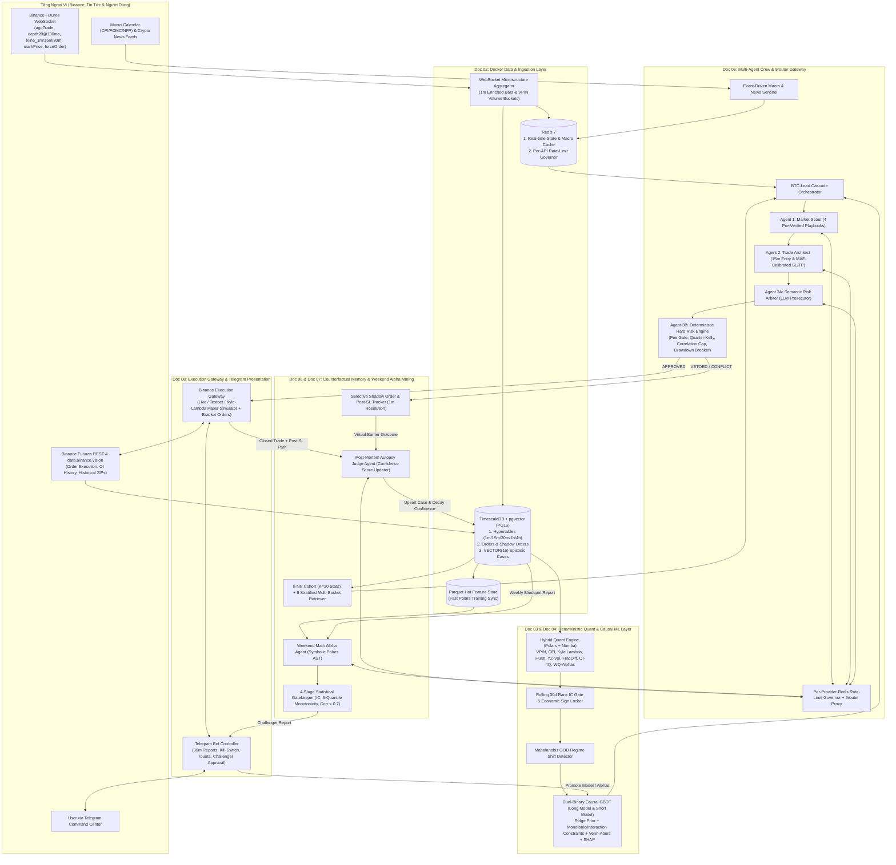

# 00 — Master Architecture Index & System Blueprint (`LLM_trading_bot_v2`)

> [!IMPORTANT]
> **Mục đích tài liệu:** Đây là tài liệu chỉ mục trung tâm (**Single Source of Truth**) định nghĩa kiến trúc tổng thể, ma trận liên kết giữa 8 Design Patterns, luồng dữ liệu thời gian thực và lộ trình triển khai cho hệ thống giao dịch định lượng đa tác tử **`LLM_trading_bot_v2`** trên sàn **Binance USD-M Perpetual Futures**.

---

## 1. Bản Đồ Tài Liệu Thiết Kế (`docs/system_design/`)

Toàn bộ hệ thống được chia thành **8 Bản thiết kế kỹ thuật chuyên sâu (Engineering Blueprints)** theo thứ tự phụ thuộc từ tầng nền tảng (Foundation & Vibecoding Harness) lên tầng thực thi (Execution & Ops):

| Mã Tài Liệu | Tên File Thiết Kế | Pattern Cốt Lõi | Tầng Clean Architecture Liên Quan |
| :--- | :--- | :--- | :--- |
| **Doc 01** | [`01_project_skeleton_and_vibecoding_harness.md`](./01_project_skeleton_and_vibecoding_harness.md) | **Khung Clean Architecture & Full Autonomous Vibecoding Harness** (`uv`, `import-linter`, `AGENTS.md` phân tầng, 3 Skills, `.agents/hooks.json` `Stop` Hook, `verify_loop`) | Toàn bộ 4 tầng (`Domain`, `Application`, `Infrastructure`, `Presentation`) |
| **Doc 02** | [`02_database_and_ingestion_pipeline.md`](./02_database_and_ingestion_pipeline.md) | **Docker Data Stack (`TimescaleDB + pgvector + Redis`) & Pipeline Thu Thập Nến `1m` Vi Cấu Trúc** (`wss://fstream.binance.com`, `data.binance.vision`, Parquet Sync) | `Domain (Entities/Ports)` $\leftrightarrow$ `Infrastructure (Persistence & Binance WS/REST)` |
| **Doc 03** | [`03_hybrid_quant_engine_and_symbolic_dsl.md`](./03_hybrid_quant_engine_and_symbolic_dsl.md) | **Hybrid Deterministic Quant Engine (`Polars + Numba`), 4 Trụ Cột Chỉ Số Nghiên Cứu, `Rolling 30d IC Gate` & `Symbolic AST DSL`** | `Domain (MarketState)` $\leftrightarrow$ `Infrastructure (Quant Engine)` |
| **Doc 04** | [`04_causal_ml_triple_barrier_and_shap.md`](./04_causal_ml_triple_barrier_and_shap.md) | **Mô Hình `Dual-Binary Causal ML` (`Long Model` & `Short Model`), `Triple-Barrier`, `Purged CV`, `Mahalanobis OOD`, `Venn-Abers` & `Locked TreeSHAP`** | `Domain (ML Ports)` $\leftrightarrow$ `Infrastructure (ML Core)` |
| **Doc 05** | [`05_multi_agents_playbooks_and_9router.md`](./05_multi_agents_playbooks_and_9router.md) | **Đội 3 Multi-Agents (`Scout`, `Architect`, `Arbiter`), `BTC-Lead Cascade`, `Per-API Redis Rate-Limit Governor` cho `9router`, `4 Playbooks`, `Macro Sentinel` & `Dual-Shield Risk`** | `Domain (Risk/Playbooks)` $\leftrightarrow$ `Application (30m Cycle)` $\leftrightarrow$ `Infrastructure (Agents)` |
| **Doc 06** | [`06_shadow_orders_and_2tier_episodic_memory.md`](./06_shadow_orders_and_2tier_episodic_memory.md) | **`Selective Shadow Orders` (`MAE/MFE/Post-SL Reversal`), `Post-Mortem Judge` & Bộ Nhớ Kép `k-NN Cohort (K=20) + 6 Stratified Multi-Bucket Lessons` trên `pgvector`** | `Domain (EpisodicCase)` $\leftrightarrow$ `Application (Reflection)` $\leftrightarrow$ `Infrastructure (Vector Store)` |
| **Doc 07** | [`07_weekend_math_agent_and_champion_challenger.md`](./07_weekend_math_agent_and_champion_challenger.md) | **`Weekend Math Alpha Agent` (Sinh công thức từ lỗi tuần), `4-Stage Statistical Gatekeeper` (Kèm `5-Quantile Monotonicity Check`) & `Champion vs. Challenger`** | `Application (Weekend Mining)` $\leftrightarrow$ `Infrastructure (Math Agent & ML Retrainer)` |
| **Doc 08** | [`08_binance_execution_telegram_and_docker_ops.md`](./08_binance_execution_telegram_and_docker_ops.md) | **`Binance Execution Gateway` (`Bracket Order` có `Hard-SL` trên sàn, `Paper/Testnet/Live`), `Telegram Command Center` & `Docker Compose` Toàn Trình** | `Infrastructure (Binance REST)` $\leftrightarrow$ `Presentation (Telegram & Scheduler)` |

---

## 2. Tổng Quan Các Quyết Định Kiến Trúc Bất Biến (Architectural Invariants)

Mọi module được viết trong dự án bắt buộc phải tuân thủ **8 Quy tắc Bất biến (Invariants)** đã được chốt:

1. **Zero LLM Arithmetic (LLM Tuyệt đối không tính toán):**
   - Toàn bộ phép tính chỉ số nghiên cứu (`VPIN`, `Hurst`, `Yang-Zhang Vol`, `Kyle's Lambda`, `OFI/OBI`, `FracDiff`, `OI 4-Quadrant`, `WorldQuant Alphas`), xác suất thắng sau phí, khoảng cách `TP/SL`, khối lượng lệnh `Quarter-Kelly` và bộ lọc phí đều do **Deterministic Python (`Polars` + `Numba`)** tính toán 100%.
2. **Thị trường, Khung Thời Gian & Rổ 4 Mã:**
   - Sàn giao dịch: **Binance USD-M Perpetual Futures** (phí Maker `0.02%`, Taker `0.05%`).
   - Rổ 4 mã: `BTCUSDT`, `ETHUSDT`, `SOLUSDT` + `1 Dynamic High-Beta Slot` (mặc định `BNBUSDT`).
   - Khung thời gian đa tầng: **`4h/1h`** (Macro Regime Context) $\rightarrow$ **`30m`** (Trigger chạy Full Pipeline ML + 3 Agents) $\rightarrow$ **`15m`** (Căn điểm vào lệnh `Limit` vs `Market`) $\rightarrow$ **`1m`** (Tầng nền lưu trữ vi cấu trúc nội nến và kiểm tra chính xác thứ tự chạm `TP/SL`).
3. **Dual-Binary Causal ML & Chống Chia Nhánh Giả Tạo:**
   - Tách riêng **2 mô hình nhị phân độc lập (`Long Barrier Model` & `Short Barrier Model`)** kết hợp `Logistic Ridge Prior` + `Shallow LightGBM/CatBoost` (`max_depth <= 4`) để áp dụng **100% khóa đơn điệu kinh tế (`monotone_constraints`)** và **khóa tương tác cụm nhân quả (`interaction_constraints`)**.
   - Kèm theo bộ phát hiện lệch phân phối **`Mahalanobis OOD Detector`** và hiệu chuẩn xác suất **`Inductive Venn-Abers Calibration`** (xuất cả xác suất $p_{\text{cal}}$ lẫn độ rộng khoảng bất định $\Delta p$).
4. **Chống LLM Ngụy Biện (Anti-Confabulation Gate):**
   - Chỉ số nào có `|Rolling 30d Rank IC| < 0.015` trên mã đó sẽ bị ẩn hoặc gắn cờ cứng `STATISTICALLY_DEAD_NOISE` (cấm LLM sử dụng).
   - Mỗi chỉ số được code gắn sẵn chiều diễn giải kinh tế `locked_economic_direction`.
   - Đội Agents bắt buộc khớp lệnh theo **4 Pre-Verified Quant Playbooks** (`TREND_CONTINUATION_BREAKOUT`, `LIQUIDATION_EXHAUSTION_REVERSAL`, `CROSS_ASSET_LEAD_LAG_CATCHUP`, `NO_TRADE_REGIME`) có kiểm tra điều kiện biên bằng code.
5. **Điều Phối `BTC-Lead Cascade` & Kiểm Soát Rate Limit Từng API Trước `9router`:**
   - Khi đóng nến `30m`, tính xong Quant + ML cho cả 4 mã trong `< 300ms`, sau đó chạy `BTCUSDT Scout` trước (`~3s`) để truyền `BTC_Realtime_Thesis` sang cho `ETHUSDT`, `SOLUSDT`, `BNBUSDT` chạy song song.
   - Tầng **`Per-Provider Redis Rate-Limit Governor`** kiểm soát riêng biệt `RPM`, `TPM`, `RPD` và `min_interval_ms` của từng API/Provider trước khi gọi `9router`, kết hợp `Event-Driven Macro & News Sentinel` dùng `SharedMacroCache` tiết kiệm 94% token tin tức.
6. **Lệnh Ảo `Selective Shadow Orders` & Bộ Nhớ Kép `k-NN Cohort (K=20) + 6 Stratified Lessons`:**
   - Mọi kèo bị `Risk Arbiter` VETO hoặc có xung đột giữa `ML` và `Agents` đều sinh ra **Lệnh ảo (`Shadow Order`)** theo dõi trên nến `1m`. Kể cả lệnh thật sau khi chạm SL vẫn được theo dõi tiếp để bắt lỗi **`STOP_HUNTED_THEN_HIT_TP`**.
   - Khi truy xuất RAG trên `pgvector` bằng `VECTOR(16)` định lượng (`0` tốn API), hệ thống lấy **Quần thể `K = 20` ca gần nhất** để tính **Thống kê Quần thể (`Cohort Win-Rate, Stop-Hunt Rate, 80th-Percentile MAE`)** và trích xuất **6 Bài học Phân tầng (`2 Bull/Missed-Opp + 2 True Failure Traps + 2 Execution/Stop-Hunt`)** gửi về đúng từng Agent.
7. **Weekend Math Agent & 4-Stage Statistical Gatekeeper:**
   - Cuối tuần, `Math Agent` đọc báo cáo lỗi trong tuần để sinh 30–50 công thức `Symbolic Polars AST` nhân quả, lọc qua 4 ải (`Zero Look-ahead`, `Rank IC >= 0.025 & 5-Quantile Monotonicity`, `Max Correlation < 0.70`, `Purged Walk-Forward CV Marginal Gain`) và gửi báo cáo `Champion vs. Challenger` về Telegram để phê duyệt.
8. **Bảo Vệ Vốn Bất Biến Trên Sàn (`Exchange-Side Bracket Order` & `Circuit Breakers`):**
   - Mọi lệnh mở trên Binance bắt buộc đi kèm lệnh `STOP_MARKET` (`reduceOnly=true`) nằm sẵn trên máy chủ Binance. Tự động ngắt cầu dao sang *Shadow Mode* nếu `Daily Drawdown >= daily_dd_limit` hoặc khóa cứng nếu `Max Drawdown >= max_dd_limit`.
9. **Zero Hardcode, Zero Default Arguments & Zero Silent Fallbacks (`Fail-Fast Discipline + AST Gate`):**
   - **Cấm tham số mặc định trong định nghĩa hàm/class:** Tuyệt đối cấm viết `def func(param: Type = default_val):` hoặc gán giá trị mặc định cho trường dữ liệu trong `Pydantic BaseModel` / `@dataclass`. Mọi tham số phải được truyền tường minh (Explicit Required Injection) từ cấu hình.
   - **Cấm gán dữ liệu mặc định dự phòng (No Silent Fallback):** Cấm viết `val if cond else hard_value`, `dict.get("k", default_val)`, hoặc `val or default_val` để lấp liếm dữ liệu thiếu. Khi thiếu dữ liệu hoặc cấu hình, hệ thống bắt buộc phải **raise Exception tường minh (`Fail-Fast`)** thay vì âm thầm chạy bằng số giả.
   - **Cấm Hardcode Magic Numbers/Strings:** Mọi hằng số ngưỡng, kích thước cửa sổ, hệ số toán học, URL, tên model đều phải được đọc từ `config/settings.yaml`, `config/rate_limits.yaml`, hoặc `config/alpha_zoo_seed.yaml`. Quy tắc này được cưỡng chế tự động bằng trình quét cây cú pháp **`scripts/check_no_defaults_or_hardcode.py` (AST Gate)** nằm trong `verify_loop`.

---

## 3. Sơ Đồ Kiến Trúc Luồng Dữ Liệu Toàn Trình (Master Dataflow Diagram)



---

## 4. Ma Trận Phân Tầng Clean Architecture & Quy Tắc Phụ Thuộc (`Import-Linter`)

Hệ thống tuân thủ quy tắc phụ thuộc một chiều hướng tâm (**Dependency Rule**):

```text
+-----------------------------------------------------------------------+
|                       TẦNG 4: PRESENTATION                            |
|   (Telegram Bot Controller, APScheduler Cron Runner, CLI, FastAPI)    |
+-----------------------------------+-----------------------------------+
                                    | chỉ gọi vào Application / Domain Ports
                                    v
+-----------------------------------------------------------------------+
|                      TẦNG 3: INFRASTRUCTURE                           |
|  - quant_engine/ (Polars, Numba, Symbolic DSL)                        |
|  - ml/           (LightGBM, CatBoost, Ridge, Venn-Abers, SHAP, OOD)   |
|  - agents/       (9router Client, Rate-Limit Governor, Prompts)       |
|  - binance/      (WebSocket Ingestor, Futures REST, Paper Simulator)  |
|  - persistence/  (TimescaleDB, pgvector Cohort Retriever, Redis)      |
+-----------------------------------+-----------------------------------+
                                    | triển khai (implements) Domain Ports
                                    v
+-----------------------------------------------------------------------+
|                       TẦNG 2: APPLICATION                             |
|  - use_cases/run_30m_trading_cycle.py   (BTC-Lead Cascade + 3 Agents) |
|  - use_cases/evaluate_shadow_orders.py  (1m Barrier & Post-SL Check)  |
|  - use_cases/reflect_and_learn.py       (Post-Mortem & Confidence)    |
|  - use_cases/run_weekend_alpha_mining.py(Math Agent & 4-Stage Gate)   |
|  - use_cases/manage_risk_and_circuit.py (Drawdown & Emergency Halt)   |
+-----------------------------------+-----------------------------------+
                                    | điều phối Domain Entities & Services
                                    v
+-----------------------------------------------------------------------+
|                    TẦNG 1: DOMAIN (LÕI BẤT BIẾN)                      |
|  - entities/ (MarketState, QuantPacket, TradeBlueprint, EpisodicCase) |
|  - services/ (RiskCalculator, PlaybookValidator, BarrierEvaluator)    |
|  - ports/    (MarketDataPort, MLModelPort, AgentPort, ExecutionPort)  |
+-----------------------------------------------------------------------+
```

---

## 5. Lộ Trình Thi Công Tuần Tự (Implementation Sequence)

Khi bắt đầu viết code từ bộ tài liệu này, chúng ta sẽ thi công theo **6 Giai đoạn Kiểm chứng Khép kín**:

1. **Stage 1 (Theo [`Doc 01`](./01_project_skeleton_and_vibecoding_harness.md)):** Khởi tạo `pyproject.toml` bằng `uv`, tạo cây thư mục, viết các file `AGENTS.md`, `.agents/skills/`, `.agents/hooks.json`, cấu hình `import-linter`, viết toàn bộ **Tầng 1 (`src/domain/`)** và chạy xanh `verify_loop` lần đầu tiên.
2. **Stage 2 (Theo [`Doc 02`](./02_database_and_ingestion_pipeline.md) & [`Doc 03`](./03_hybrid_quant_engine_and_symbolic_dsl.md)):** Dựng `docker-compose.yml` cho `TimescaleDB + pgvector + Redis`, chạy migration tạo bảng, viết `Historical Backfiller` + `WebSocket 1m Microstructure Ingestor`, và hoàn thiện `Hybrid Quant Engine` + `Symbolic DSL` vượt qua bài test `Zero Look-Ahead Bias`.
3. **Stage 3 (Theo [`Doc 04`](./04_causal_ml_triple_barrier_and_shap.md)):** Xây dựng `Triple-Barrier Labeler` trên nến `1m`, `Purged K-Fold CV`, huấn luyện cặp mô hình `Dual-Binary Causal GBDT` (`Long Model` & `Short Model`), tích hợp `Mahalanobis OOD`, `Venn-Abers Calibrator` và `Economic-Locked TreeSHAP`.
4. **Stage 4 (Theo [`Doc 05`](./05_multi_agents_playbooks_and_9router.md)):** Xây dựng `Per-Provider Redis Rate-Limit Governor` kết nối `9router`, dịch vụ `Event-Driven Macro & News Sentinel`, đội 3 Agents (`Scout`, `Trade Architect`, `Risk Arbiter`) chạy theo cơ chế `BTC-Lead Cascade` và chốt chặn `Dual-Shield Risk Engine`.
5. **Stage 5 (Theo [`Doc 06`](./06_shadow_orders_and_2tier_episodic_memory.md) & [`Doc 07`](./07_weekend_math_agent_and_champion_challenger.md)):** Xây dựng `Selective Shadow Order Engine`, `Post-Mortem Autopsy Judge`, bộ truy xuất `k-NN Cohort (K=20) + 6 Stratified Multi-Bucket Memory` trên `pgvector`, và luồng `Weekend Math Alpha Agent` + `4-Stage Gatekeeper`.
6. **Stage 6 (Theo [`Doc 08`](./08_binance_execution_telegram_and_docker_ops.md)):** Hoàn thiện `Binance Execution Gateway` (`Bracket Order` có `Hard-SL` trên sàn + `Paper Simulator`), `Telegram Bot Command Center` và đóng gói vận hành 24/7 trên Docker.
