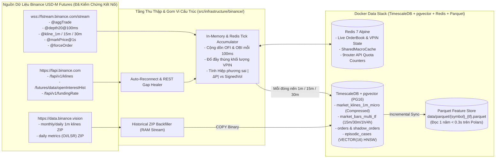

# 02 — Thiết Kế Database Docker (`TimescaleDB + pgvector + Redis`) & Pipeline Thu Thập Dữ Liệu

> [!IMPORTANT]
> **Mục tiêu Pattern 2:** Xây dựng hạ tầng dữ liệu hiệu năng cao trên Docker hợp nhất cả **Time-Series Hypertables (`TimescaleDB`)** và **Vector Search (`pgvector`)** trong một container `PostgreSQL 16` duy nhất (`timescale/timescaledb-ha:pg16`), đi kèm **`Redis 7`** và **`Parquet Feature Store`**. Thu thập dữ liệu thời gian thực từ **Binance USD-M Futures WebSocket (`wss://fstream.binance.com/stream`)** gom về tầng nền **Nến `1m` giàu vi cấu trúc (`~60MB/năm` cho 4 mã)** để tính chuẩn xác `VPIN`, `Kyle's Lambda`, `OFI/OBI` nội nến `30m` và xét chính xác thứ tự chạm `TP vs. SL` tới từng phút.

---

## 1. Sơ Đồ Kiến Trúc Luồng Thu Thập & Lưu Trữ Dữ Liệu



---

## 2. Tại Sao Lưu Tầng Nền `1m Enriched Microstructure Bars` Là Quyết Định Tối Ưu?

Khi giao dịch ở khung chính `30m` (kèm căn điểm vào ở `15m`), việc lưu trữ tầng nền nến `1m` đã làm giàu vi cấu trúc giải quyết **3 bài toán sống còn** mà không làm phình ổ cứng:

1. **Tính chính xác `Kyle's Lambda` ($\lambda$) và `OFI/OBI` nội nến `30m`:**
   - Trong mỗi cây nến `30m`, có đúng **30 điểm mẫu nến `1m`**. Nhờ 30 điểm mẫu này, `Quant Engine` chạy được hồi quy tuyến tính $|\Delta P_{1m}| = \alpha + \lambda \cdot |\text{SignedVolume}_{1m}| + \epsilon$ để đo độ mỏng sổ lệnh và dự báo trượt giá thực tế trước khi đặt lệnh.
2. **Không làm mất dấu vết cá mập trong `VPIN`:**
   - Nếu cá mập gom hàng 15 phút đầu và xả 15 phút cuối của cây nến `30m`, việc nhìn vào nến `1m` (và các thùng khối lượng `Volume Buckets`) giúp bắt trọn độ lệch $|V_B - V_S|$ mà cây nến `30m` gộp bị triệt tiêu.
3. **Phân xử chính xác 100% thứ tự chạm `TP` vs. `SL` cho `Triple-Barrier` & `Shadow Orders`:**
   - Khi một cây nến `30m` biến động mạnh quét qua cả mức `TP` và `SL`, chuỗi 30 cây nến `1m` bên trong cho biết chính xác tới từng phút lệnh đã chạm `TP` trước hay chạm `SL` trước (và sau khi chạm `SL` ở phút thứ 5 thì đến phút thứ 25 giá có quay lại chạm `TP` hay không để bắt lỗi `STOP_HUNTED_THEN_HIT_TP`).
4. **Chi phí dung lượng cực nhỏ:**
   - `4 mã × 1,440 phút/ngày × 365 ngày = 2,102,400 dòng/năm`. Với tính năng nén cột tự động (`TimescaleDB Columnar Compression`) và định dạng `Parquet Zstd`, toàn bộ 1 năm dữ liệu của cả 4 mã chỉ chiếm **`~55 – 65 MB`**.

---

## 3. Thiết Kế Schema Cơ Sở Dữ Liệu Đầy Đủ (`sql/001_init_schema.sql`)

Dưới đây là toàn bộ câu lệnh khởi tạo `TimescaleDB Hypertables`, chính sách nén tự động và bảng `pgvector` sẽ được mount tự động vào `/docker-entrypoint-initdb.d/` của container `timescaledb-ha:pg16`:

```sql
-- Kích hoạt cả 2 extensions cốt lõi trên cùng 1 database
CREATE EXTENSION IF NOT EXISTS timescaledb CASCADE;
CREATE EXTENSION IF NOT EXISTS vector CASCADE;

-- ============================================================================
-- BẢNG 1: TẦNG NỀN NẾN 1M GIÀU VI CẤU TRÚC (market_klines_1m_micro)
-- ============================================================================
CREATE TABLE IF NOT EXISTS market_klines_1m_micro (
    open_time               TIMESTAMPTZ NOT NULL,
    symbol                  VARCHAR(16) NOT NULL,
    open                    DOUBLE PRECISION NOT NULL,
    high                    DOUBLE PRECISION NOT NULL,
    low                     DOUBLE PRECISION NOT NULL,
    close                   DOUBLE PRECISION NOT NULL,
    volume                  DOUBLE PRECISION NOT NULL,
    quote_volume            DOUBLE PRECISION NOT NULL,
    taker_buy_vol           DOUBLE PRECISION NOT NULL,
    taker_buy_quote_vol     DOUBLE PRECISION NOT NULL,
    trade_count             INTEGER NOT NULL,
    -- Các trường Vi cấu trúc cộng dồn từ WebSocket aggTrade & depth20@100ms (Bắt buộc truyền tường minh, cấm DEFAULT)
    ofi_sum                 DOUBLE PRECISION NOT NULL, -- Order Flow Imbalance tích lũy trong 1m
    obi_mean                DOUBLE PRECISION NOT NULL, -- Trung bình Order Book Imbalance (-1..+1)
    obi_std                 DOUBLE PRECISION NOT NULL, -- Độ lệch chuẩn OBI trong 1m
    spread_bps_mean         DOUBLE PRECISION NOT NULL, -- Bid-Ask Spread trung bình (basis points)
    liq_long_usd            DOUBLE PRECISION NOT NULL, -- Thanh lý Long (từ luồng forceOrder)
    liq_short_usd           DOUBLE PRECISION NOT NULL, -- Thanh lý Short (từ luồng forceOrder)
    PRIMARY KEY (symbol, open_time)
);

-- Chuyển thành TimescaleDB Hypertable (chia chunk theo từng 7 ngày)
SELECT create_hypertable('market_klines_1m_micro', 'open_time', chunk_time_interval => INTERVAL '7 days', if_not_exists => TRUE);

-- Bật nén cột tự động cho các chunk cũ hơn 7 ngày (giảm 92% dung lượng đĩa)
ALTER TABLE market_klines_1m_micro SET (
    timescaledb.compress,
    timescaledb.compress_segmentby = 'symbol',
    timescaledb.compress_orderby = 'open_time DESC'
);
SELECT add_compression_policy('market_klines_1m_micro', INTERVAL '7 days', if_not_exists => TRUE);

-- ============================================================================
-- BẢNG 2: NẾN ĐA KHUNG (15m, 30m, 1h, 4h) KÈM DỮ LIỆU PHÁI SINH (OI & FUNDING)
-- ============================================================================
CREATE TABLE IF NOT EXISTS market_bars_multi_tf (
    open_time               TIMESTAMPTZ NOT NULL,
    symbol                  VARCHAR(16) NOT NULL,
    timeframe               VARCHAR(8)  NOT NULL, -- '15m', '30m', '1h', '4h'
    open                    DOUBLE PRECISION NOT NULL,
    high                    DOUBLE PRECISION NOT NULL,
    low                     DOUBLE PRECISION NOT NULL,
    close                   DOUBLE PRECISION NOT NULL,
    volume                  DOUBLE PRECISION NOT NULL,
    quote_volume            DOUBLE PRECISION NOT NULL,
    taker_buy_vol           DOUBLE PRECISION NOT NULL,
    trade_count             INTEGER NOT NULL DEFAULT 0,
    -- Dữ liệu Phái sinh đồng bộ tại thời điểm đóng nến
    open_interest           DOUBLE PRECISION,     -- Tổng khối lượng hợp đồng mở (Coins)
    open_interest_value_usd DOUBLE PRECISION,     -- Giá trị OI tính bằng USDT
    funding_rate            DOUBLE PRECISION,     -- Lãi suất Funding hiện hành
    mark_price              DOUBLE PRECISION,
    top_trader_ls_ratio     DOUBLE PRECISION,     -- Tỷ lệ Long/Short của Top Traders (từ Binance metrics)
    liq_long_usd            DOUBLE PRECISION NOT NULL DEFAULT 0.0,
    liq_short_usd           DOUBLE PRECISION NOT NULL DEFAULT 0.0,
    PRIMARY KEY (symbol, timeframe, open_time)
);

SELECT create_hypertable('market_bars_multi_tf', 'open_time', chunk_time_interval => INTERVAL '30 days', if_not_exists => TRUE);

-- ============================================================================
-- BẢNG 3: SNAPSHOT ĐẶC TRƯNG ĐỊNH LƯỢNG, ROLLING IC & DỰ BÁO ML MỖI 30M
-- ============================================================================
CREATE TABLE IF NOT EXISTS quant_ml_snapshots_30m (
    bar_time                TIMESTAMPTZ NOT NULL,
    symbol                  VARCHAR(16) NOT NULL,
    regime_label            VARCHAR(32) NOT NULL,
    hurst_exp               DOUBLE PRECISION NOT NULL,
    yang_zhang_vol          DOUBLE PRECISION NOT NULL,
    vpin_value              DOUBLE PRECISION NOT NULL,
    kyle_lambda             DOUBLE PRECISION NOT NULL,
    oi_quadrant             VARCHAR(24) NOT NULL,
    ood_mahalanobis_dist    DOUBLE PRECISION NOT NULL,
    is_ood_warning          BOOLEAN NOT NULL DEFAULT FALSE,
    -- Dự báo của Dual-Binary Causal GBDT
    p_long_win_cal          DOUBLE PRECISION NOT NULL,
    p_long_uncertainty      DOUBLE PRECISION NOT NULL,
    p_short_win_cal         DOUBLE PRECISION NOT NULL,
    p_short_uncertainty     DOUBLE PRECISION NOT NULL,
    model_version           VARCHAR(64) NOT NULL,
    features_json           JSONB NOT NULL,       -- Toàn bộ giá trị Z-score & Rolling 30d IC
    shap_explanation_json   JSONB NOT NULL,       -- Top-5 Bullish & Top-3 Bearish SHAP drivers
    PRIMARY KEY (symbol, bar_time)
);

SELECT create_hypertable('quant_ml_snapshots_30m', 'bar_time', chunk_time_interval => INTERVAL '30 days', if_not_exists => TRUE);

-- ============================================================================
-- BẢNG 4: LỆNH THẬT / PAPER ORDERS & LỆNH ẢO (SHADOW ORDERS)
-- ============================================================================
CREATE TABLE IF NOT EXISTS trade_and_shadow_orders (
    order_id                UUID PRIMARY KEY,
    created_at              TIMESTAMPTZ NOT NULL,
    bar_time_30m            TIMESTAMPTZ NOT NULL,
    symbol                  VARCHAR(16) NOT NULL,
    is_shadow_order         BOOLEAN NOT NULL,     -- FALSE = Lệnh thật/Paper khớp lệnh; TRUE = Lệnh ảo bị Veto/Skip
    execution_mode          VARCHAR(16) NOT NULL, -- 'LIVE', 'TESTNET', 'PAPER', 'SHADOW'
    playbook_used           VARCHAR(40) NOT NULL,
    side                    VARCHAR(8)  NOT NULL, -- 'LONG' | 'SHORT'
    entry_type              VARCHAR(24) NOT NULL, -- 'MARKET' | 'LIMIT_PULLBACK_15M'
    entry_price             DOUBLE PRECISION NOT NULL,
    stop_loss_price         DOUBLE PRECISION NOT NULL,
    take_profit_price       DOUBLE PRECISION NOT NULL,
    vertical_barrier_time   TIMESTAMPTZ NOT NULL,
    notional_usd            DOUBLE PRECISION NOT NULL,
    leverage                INTEGER NOT NULL DEFAULT 1,
    isolated_margin_usd     DOUBLE PRECISION NOT NULL,     -- Ký quỹ Isolated thực tế của lệnh
    is_sl_at_breakeven      BOOLEAN NOT NULL,              -- Đánh dấu lệnh đã dời SL về hòa vốn (Effective Risk = 0)
    effective_at_risk_usd   DOUBLE PRECISION NOT NULL,     -- Rủi ro mất vốn thực tế còn lại (USD)
    veto_category           VARCHAR(32),                   -- 'SETUP_DEFECT' | 'PORTFOLIO_CAPACITY_VETO' | NULL
    account_context_json    JSONB NOT NULL,                -- Snapshot AccountPortfolioContext lúc Risk Arbiter ra quyết định
    -- Trạng thái vòng đời & Giải phẫu đường giá (Autopsy Path trên nến 1m)
    status                  VARCHAR(24) NOT NULL, -- 'OPEN', 'CLOSED_TP', 'CLOSED_SL', 'CLOSED_TIMEOUT', 'POST_SL_TRACKING'
    closed_at               TIMESTAMPTZ,
    exit_price              DOUBLE PRECISION,
    net_pnl_pct             DOUBLE PRECISION,
    net_pnl_usd             DOUBLE PRECISION,
    mae_pct                 DOUBLE PRECISION NOT NULL DEFAULT 0.0, -- Max Adverse Excursion (%)
    mfe_pct                 DOUBLE PRECISION NOT NULL DEFAULT 0.0, -- Max Favorable Excursion (%)
    did_hit_tp_after_sl     BOOLEAN NOT NULL DEFAULT FALSE,        -- Phát hiện lỗi Stop-Hunt rồi mới về TP
    post_sl_max_favorable   DOUBLE PRECISION DEFAULT 0.0,
    outcome_category        VARCHAR(40),
    agent_debate_json       JSONB NOT NULL                         -- Lưu đầy đủ luận điểm Scout, Architect, Arbiter
);

CREATE INDEX IF NOT EXISTS idx_orders_status_symbol ON trade_and_shadow_orders (status, symbol, created_at DESC);

-- ============================================================================
-- BẢNG 5: KHO BỘ NHỚ CA BỆNH 2 TẦNG TRÊN PGVECTOR (episodic_cases)
-- ============================================================================
CREATE TABLE IF NOT EXISTS episodic_cases (
    case_id                 UUID PRIMARY KEY,
    created_at              TIMESTAMPTZ NOT NULL DEFAULT NOW(),
    updated_at              TIMESTAMPTZ NOT NULL DEFAULT NOW(),
    symbol                  VARCHAR(16) NOT NULL,
    playbook_used           VARCHAR(40) NOT NULL,
    side                    VARCHAR(8)  NOT NULL,
    outcome_category        VARCHAR(40) NOT NULL, -- 'VALIDATED_WIN', 'FALSE_POSITIVE_TRAP', 'STOP_HUNTED_THEN_HIT_TP', 'MISSED_OPPORTUNITY', 'VALIDATED_DEFENSE'
    confidence_score        DOUBLE PRECISION NOT NULL DEFAULT 0.55,
    is_archived             BOOLEAN NOT NULL DEFAULT FALSE,
    -- Vector định lượng 16 chiều (Static Regime + 3-Bar Trajectory) để tìm k-NN K=20 trong < 3ms
    regime_trajectory_vec    vector(16) NOT NULL,
    -- Thống kê đường giá của ca bệnh phục vụ tính Cohort Base-Rate Summary
    realized_r_multiple     DOUBLE PRECISION NOT NULL,
    mae_atr_multiple        DOUBLE PRECISION NOT NULL,
    mfe_atr_multiple        DOUBLE PRECISION NOT NULL,
    did_hit_tp_after_sl     BOOLEAN NOT NULL DEFAULT FALSE,
    -- Hồ sơ chi tiết 2 tầng
    tier_1_index_json       JSONB NOT NULL,
    tier_2_dossier_json     JSONB NOT NULL
);

-- Chỉ mục HNSW siêu tốc trên pgvector theo khoảng cách Cosine / L2
CREATE INDEX IF NOT EXISTS idx_episodic_cases_vec_hnsw
    ON episodic_cases USING hnsw (regime_trajectory_vec vector_l2_ops)
    WITH (m = 16, ef_construction = 64);

CREATE INDEX IF NOT EXISTS idx_episodic_cases_active
    ON episodic_cases (is_archived, symbol, outcome_category, confidence_score DESC);

-- ============================================================================
-- BẢNG 6: KHO CÔNG THỨC ALPHA (alpha_zoo_registry) & PHIÊN BẢN MODEL
-- ============================================================================
CREATE TABLE IF NOT EXISTS alpha_zoo_registry (
    alpha_id                VARCHAR(64) PRIMARY KEY,
    created_at              TIMESTAMPTZ NOT NULL DEFAULT NOW(),
    source_type             VARCHAR(24) NOT NULL, -- 'SEED_RESEARCH', 'WORLDQUANT_101', 'WEEKEND_MATH_AGENT'
    dsl_expression          TEXT NOT NULL,        -- Biểu thức Symbolic Polars AST
    causal_cluster          VARCHAR(32) NOT NULL, -- 'REGIME', 'MICROSTRUCTURE', 'DERIVATIVES', 'CROSS_ASSET'
    long_monotonic_prior    SMALLINT NOT NULL,    -- -1, 0, +1
    short_monotonic_prior   SMALLINT NOT NULL,    -- -1, 0, +1
    economic_rationale      TEXT NOT NULL,
    oos_rank_ic             DOUBLE PRECISION NOT NULL,
    oos_icir                DOUBLE PRECISION NOT NULL,
    quantile_monotonicity   DOUBLE PRECISION NOT NULL,
    is_active_in_champion   BOOLEAN NOT NULL DEFAULT TRUE
);

-- ============================================================================
-- BẢNG 7: LỊCH SỬ TRẠNG THÁI TÀI KHOẢN, MARGIN & DRAWDOWN (account_equity_snapshots)
-- Phục vụ lắp ráp AccountPortfolioContext cho Agent 3 (Risk Arbiter) & Kiểm toán Drawdown
-- ============================================================================
CREATE TABLE IF NOT EXISTS account_equity_snapshots (
    snapshot_time           TIMESTAMPTZ NOT NULL,
    execution_mode          VARCHAR(16) NOT NULL, -- 'LIVE', 'TESTNET', 'PAPER'
    wallet_balance_usd      DOUBLE PRECISION NOT NULL,
    unrealized_pnl_usd      DOUBLE PRECISION NOT NULL,
    equity_nav_usd          DOUBLE PRECISION NOT NULL,
    used_margin_usd         DOUBLE PRECISION NOT NULL,
    available_margin_usd    DOUBLE PRECISION NOT NULL,
    margin_utilization_pct  DOUBLE PRECISION NOT NULL,
    open_positions_count    INTEGER NOT NULL,
    raw_open_heat_pct       DOUBLE PRECISION NOT NULL,
    effective_open_heat_pct DOUBLE PRECISION NOT NULL,
    net_btc_beta_usd        DOUBLE PRECISION NOT NULL,
    daily_dd_pct            DOUBLE PRECISION NOT NULL,
    max_dd_pct              DOUBLE PRECISION NOT NULL,
    consecutive_losses      INTEGER NOT NULL,
    positions_snapshot_json JSONB NOT NULL,
    PRIMARY KEY (execution_mode, snapshot_time)
);

SELECT create_hypertable('account_equity_snapshots', 'snapshot_time', chunk_time_interval => INTERVAL '30 days', if_not_exists => TRUE);
```

---

## 4. Đặc Tả Bộ Thu Thập WebSocket Thời Gian Thực (`ws_micro_ingestor.py`)

Bộ `BinanceFuturesWSIngestor` mở một kết nối Multiplexed Stream duy nhất tới `wss://fstream.binance.com/stream` cho cả 4 mã (`btcusdt`, `ethusdt`, `solusdt`, `bnbusdt`) và thực hiện cộng dồn vi cấu trúc trong RAM:

### 4.1. Công Thức Cộng Dồn `OFI` & `OBI` Mỗi 100ms Trên Sổ Lệnh (`@depth20@100ms`)

Theo nghiên cứu của **Cont, Kukanov & Stoikov (2014) — *"The Price Impact of Order Book Events"***:
- Gọi $(P_t^b, q_t^b)$ và $(P_t^a, q_t^a)$ là giá và khối lượng ở mức Bid tốt nhất và Ask tốt nhất tại lần cập nhật thứ $t$.
- Biến thiên dòng lệnh chờ `Order Flow Imbalance` ($e_t$) tại mỗi nhịp `100ms` được tính bằng:
  $$e_t = I_{\{P_t^b \ge P_{t-1}^b\}} q_t^b - I_{\{P_t^b \le P_{t-1}^b\}} q_{t-1}^b - I_{\{P_t^a \le P_{t-1}^a\}} q_t^a + I_{\{P_t^a \ge P_{t-1}^a\}} q_{t-1}^a$$
- Tổng $\text{OFI}_{1m} = \sum_{t \in \text{1m}} e_t$.
- Đồng thời, tỷ lệ mất cân bằng độ sâu 10 mức giá đầu tiên (`Order Book Imbalance - OBI`) có trọng số suy giảm theo khoảng cách mức giá $l \in \{1..10\}$ ($w_l = e^{-0.2(l-1)}$):
  $$\text{OBI}_t = \frac{\sum_{l=1}^{10} w_l V_{t, l}^{\text{bid}} - \sum_{l=1}^{10} w_l V_{t, l}^{\text{ask}}}{\sum_{l=1}^{10} w_l V_{t, l}^{\text{bid}} + \sum_{l=1}^{10} w_l V_{t, l}^{\text{ask}}} \in [-1, +1]$$

### 4.2. Cấu Trúc Code `MinuteMicroAccumulator` (`src/infrastructure/binance/ws_micro_ingestor.py`)

Tuân thủ quy tắc **Zero Default Field Values & Zero Hardcode**: mọi trường được khởi tạo tường minh qua `create_empty()` và các tham số vi cấu trúc (`obi_levels`, `obi_decay_rate`, `bps_scale`) được truyền từ `MicrostructureConfig`:

```python
from __future__ import annotations

from dataclasses import dataclass
import math


@dataclass
class MicroIngestorConfig:
    obi_depth_levels: int
    obi_decay_rate: float
    bps_scale_factor: float


@dataclass
class MinuteMicroAccumulator:
    """Bộ tích lũy vi cấu trúc trong RAM cho 1 mã trong suốt 1 phút (Không gán giá trị mặc định trong khai báo field)."""
    symbol: str
    minute_open_ts_ms: int
    cfg: MicroIngestorConfig
    ofi_sum: float
    obi_samples: list[float]
    spread_bps_samples: list[float]
    liq_long_usd: float
    liq_short_usd: float
    prev_best_bid_p: float | None
    prev_best_bid_q: float
    prev_best_ask_p: float
    prev_best_ask_q: float
    has_prev_quote: bool

    @classmethod
    def create_empty(
        cls,
        symbol: str,
        minute_open_ts_ms: int,
        cfg: MicroIngestorConfig,
    ) -> MinuteMicroAccumulator:
        return cls(
            symbol=symbol,
            minute_open_ts_ms=minute_open_ts_ms,
            cfg=cfg,
            ofi_sum=0.0,
            obi_samples=[],
            spread_bps_samples=[],
            liq_long_usd=0.0,
            liq_short_usd=0.0,
            prev_best_bid_p=None,
            prev_best_bid_q=0.0,
            prev_best_ask_p=0.0,
            prev_best_ask_q=0.0,
            has_prev_quote=False,
        )

    def on_depth_update(self, bids: list[tuple[float, float]], asks: list[tuple[float, float]]) -> None:
        if not bids or not asks:
            raise ValueError(f"[{self.symbol}] Nhận bản tin OrderBook rỗng bất hợp lệ từ WebSocket.")
        b_p, b_q = bids[0]
        a_p, a_q = asks[0]

        # 1. Cập nhật Cont-Kukanov-Stoikov OFI (Không dùng biểu thức ternary fallback hằng số)
        if self.has_prev_quote and self.prev_best_bid_p is not None:
            e_bid = 0.0
            if b_p >= self.prev_best_bid_p:
                e_bid += b_q
            if b_p <= self.prev_best_bid_p:
                e_bid -= self.prev_best_bid_q

            e_ask = 0.0
            if a_p <= self.prev_best_ask_p:
                e_ask += a_q
            if a_p >= self.prev_best_ask_p:
                e_ask -= self.prev_best_ask_q

            self.ofi_sum += e_bid - e_ask

        self.prev_best_bid_p = b_p
        self.prev_best_bid_q = b_q
        self.prev_best_ask_p = a_p
        self.prev_best_ask_q = a_q
        self.has_prev_quote = True

        # 2. Tính Weighted Multi-Level OBI & Spread (bps) từ cấu hình tường minh
        mid = 0.5 * (b_p + a_p)
        if mid <= 0.0:
            raise ValueError(f"[{self.symbol}] Giá Mid-price không dương bất hợp lệ: {mid}")
        self.spread_bps_samples.append(((a_p - b_p) / mid) * self.cfg.bps_scale_factor)

        levels = self.cfg.obi_depth_levels
        decay = self.cfg.obi_decay_rate
        w_bid = sum(math.exp(-decay * i) * q for i, (_, q) in enumerate(bids[:levels]))
        w_ask = sum(math.exp(-decay * i) * q for i, (_, q) in enumerate(asks[:levels]))
        denom = w_bid + w_ask
        if denom > 0.0:
            self.obi_samples.append((w_bid - w_ask) / denom)

    def on_force_order(self, side: str, price: float, qty: float) -> None:
        usd_val = price * qty
        if side == "SELL":
            self.liq_long_usd += usd_val
        elif side == "BUY":
            self.liq_short_usd += usd_val
        else:
            raise ValueError(f"[{self.symbol}] Side thanh lý không hợp lệ: {side}")
```

---

## 5. Đặc Tả Bộ Tải Lịch Sử `HistoricalBackfiller` (`data.binance.vision` + Parquet Sync)

Để mô hình ML có ngay 6–12 tháng dữ liệu nến `1m`, `15m`, `30m`, `1h`, `4h` và lịch sử `Open Interest` chuẩn xác mà không bị giới hạn 30 ngày của REST API:

1. **Tải song song file ZIP tháng/ngày từ `https://data.binance.vision`:**
   - Đường dẫn nến: `https://data.binance.vision/data/futures/um/monthly/klines/{SYMBOL}/{TF}/{SYMBOL}-{TF}-{YYYY}-{MM}.zip`
   - Đường dẫn phái sinh (`Open Interest` & `Top Trader L/S Ratio` mỗi 5m): `https://data.binance.vision/data/futures/um/daily/metrics/{SYMBOL}/{SYMBOL}-metrics-{YYYY}-{MM}-{DD}.zip`
2. **Giải nén trực tiếp trên RAM (`io.BytesIO` + `zipfile`) sang `Polars DataFrame`:**
   - Không tạo rác file CSV tạm trên ổ cứng.
   - Ghi hàng loạt vào `TimescaleDB` qua giao thức nhị phân `asyncpg.copy_records_to_table` (tốc độ `~150,000 dòng/giây`) và lưu bản sao ra `data/parquet/{symbol}_{tf}.parquet`.

---

## 6. Checklist Nghiệm Thu Stage 2 (`Doc 02`)

- [ ] Khởi chạy container `timescaledb-ha:pg16` và `redis:7-alpine`, xác nhận `SELECT * FROM pg_extension` có cả `timescaledb` và `vector`.
- [ ] Chạy `scripts/backfill_historical.py` tải thành công dữ liệu lịch sử 4 mã (`BTCUSDT`, `ETHUSDT`, `SOLUSDT`, `BNBUSDT`) vào `TimescaleDB` và xuất file `Parquet`.
- [ ] Chạy `BinanceFuturesWSIngestor` trong 5 phút thực tế, kiểm tra bảng `market_klines_1m_micro` tự động có đủ `ofi_sum`, `obi_mean`, `spread_bps_mean` và `taker_buy_vol`.
