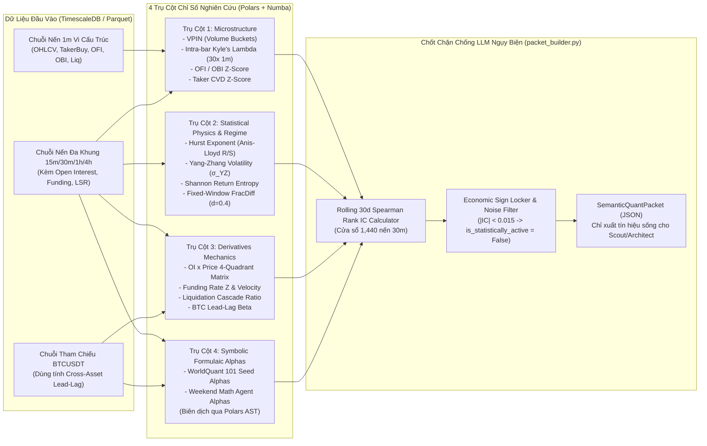

# 03 — Thiết Kế Hybrid Deterministic Quant Engine (`Polars + Numba`), `Rolling 30d IC Gate` & `Symbolic AST DSL`

> [!IMPORTANT]
> **Mục tiêu Pattern 3:** Hiện thực hóa toàn bộ tầng tính toán định lượng bằng **Code thuần (`Polars` vector hóa + `Numba JIT`)** tốc độ `< 150ms` cho 4 mã, đảm bảo **0% Look-ahead Bias**. Đóng gói 4 trụ cột chỉ số nghiên cứu học thuật thành `SemanticQuantPacket` có tích hợp **Bộ lọc `Rolling 30d Rank IC Gate`** (ẩn toàn bộ chỉ số nhiễu `|IC| < 0.015`) và **Khóa cứng Chiều diễn giải Kinh tế (`locked_economic_direction`)** để triệt tiêu hoàn toàn khả năng LLM tự bịa lý do.

---

## 1. Kiến Trúc Tầng `Hybrid Quant Engine` (`src/infrastructure/quant_engine/`)



---

## 2. Đặc Tả Toán Học & Thuật Toán `Numba / Polars` Cho 4 Trụ Cột Chỉ Số

### 2.1. Trụ Cột 1: Vi Cấu Trúc Thị Trường (`src/infrastructure/quant_engine/microstructure.py`)

#### A. `VPIN` (*Volume-Synchronized Probability of Informed Trading* — Easley, López de Prado, O'Hara, 2012)
- Thay vì chia theo thời gian cố định, dòng khối lượng giao dịch trên chuỗi nến `1m` được rót liên tục vào các **Thùng Khối Lượng (`Volume Buckets`)** có kích thước chuẩn $V_{\text{bucket}} = \frac{1}{50} \text{ADV}_{20\text{d}}$ (1/50 khối lượng giao dịch trung bình ngày).
- Trong mỗi thùng $\tau$, khối lượng mua chủ động $V_\tau^B$ và bán chủ động $V_\tau^S = V_{\text{bucket}} - V_\tau^B$ được lấy trực tiếp từ `taker_buy_vol` kết hợp quy tắc phân loại chuẩn hóa Bulk Volume Classification (BVC):
  $$\text{VPIN}_t = \frac{\sum_{\tau=k-n+1}^{k} |V_\tau^B - V_\tau^S|}{n \cdot V_{\text{bucket}}} \in [0, 1], \quad n = 50 \text{ thùng}$$
- **Chiều kinh tế khóa cứng (`locked_economic_direction`):**
  - `VPIN` không phải chỉ báo hướng đi mà là **chỉ báo Độc tố Dòng lệnh (Toxicity / Adverse Selection Risk)**. Khi `VPIN_Percentile > 85%`, khóa cứng nhãn: `"HIGH_ORDERFLOW_TOXICITY_WIDEN_SL_OR_WAIT"`.

#### B. `Intra-Bar Kyle's Lambda` ($\lambda_t$ — Đo Độ Mỏng Thanh Khoản & Dự Báo Trượt Giá)
- Với mỗi cây nến `30m` kết thúc tại $t$, lấy đúng **30 cây nến `1m`** bên trong $(i = 1..30)$.
- Gọi $\Delta P_i = \frac{|C_i - O_i|}{O_i}$ là biên độ dịch chuyển giá tương đối phút thứ $i$, và $SV_i = |2 \cdot V_i^{\text{taker\_buy}} - V_i^{\text{total}}| \cdot C_i$ là khối lượng ròng chủ động tính bằng USD.
- Hệ số **Kyle's Lambda** ($\lambda_t$) được ước lượng trên cửa sổ trượt 6 cây nến `30m` gần nhất ($180$ điểm mẫu `1m`):
  $$\lambda_t = \frac{\sum_{i=1}^{180} \Delta P_i \cdot SV_i}{\sum_{i=1}^{180} SV_i^2 + \epsilon}$$
- **Ước lượng trượt giá một chiều (`estimated_slippage_pct`) cho cỡ lệnh $Q_{\text{USD}}$:**
  $$\hat{s}_t(Q_{\text{USD}}) = \max\left(0.0001, \; 0.5 \cdot \text{Spread}_{\text{bps}, t} \cdot 10^{-4} + \lambda_t \cdot Q_{\text{USD}}\right)$$

---

### 2.2. Trụ Cột 2: Vật Lý Thống Kê & Nhận Diện Chế Độ Thị Trường (`src/infrastructure/quant_engine/regime_physics.py`)

#### A. `Hurst Exponent` ($H_t$) Có Hiệu Chỉnh Mẫu Nhỏ Anis-Lloyd (Chạy Bằng `Numba JIT`)
- Trên cửa sổ trượt $N = 100$ cây nến `30m`, chuỗi lợi nhuận logarit $r_k = \ln(C_k / C_{k-1})$ được chia thành các đoạn con để tính thống kê Rescaled Range $(R/S)_n$:
  $$\mathbb{E}\left[\left(\frac{R}{S}\right)_n\right]_{\text{Anis-Lloyd}} = \frac{\Gamma\left(\frac{n-1}{2}\right)}{\sqrt{\pi} \cdot \Gamma\left(\frac{n}{2}\right)} \sum_{i=1}^{n-1} \sqrt{\frac{n - i}{i}}$$
- Độ lệch giữa $\log(R/S)_n$ thực nghiệm và kỳ vọng lý thuyết của chuỗi ngẫu nhiên cho ra hệ số $H_t$ không bị chệch ở mẫu nhỏ:
  - $H_t > 0.55$: Khóa nhãn `"PERSISTENT_TRENDING_REGIME (Favor Breakout / Momentum)"`.
  - $H_t < 0.45$: Khóa nhãn `"MEAN_REVERTING_REGIME (Favor Range Fade / Exhaustion)"`.
  - $0.45 \le H_t \le 0.55$: Khóa nhãn `"RANDOM_WALK_NOISE_REGIME (High Chop Risk)"`.

#### B. `Yang-Zhang Volatility Estimator` ($\sigma_{YZ, t}$)
- Sử dụng toàn bộ thông tin `Open, High, Low, Close` trên cửa sổ $N = 20$ cây nến `30m`:
  $$\sigma_O^2 = \frac{1}{N-1}\sum_{i=1}^N \left(\ln\frac{O_i}{C_{i-1}} - \bar{o}\right)^2, \quad \sigma_C^2 = \frac{1}{N-1}\sum_{i=1}^N \left(\ln\frac{C_i}{O_i} - \bar{c}\right)^2$$
  $$\sigma_{RS}^2 = \frac{1}{N}\sum_{i=1}^N \left[\ln\frac{H_i}{C_i}\ln\frac{H_i}{O_i} + \ln\frac{L_i}{C_i}\ln\frac{L_i}{O_i}\right], \quad k = \frac{0.34}{1.34 + \frac{N+1}{N-1}}$$
  $$\sigma_{YZ, t} = \sqrt{\sigma_O^2 + k\sigma_C^2 + (1 - k)\sigma_{RS}^2}$$

#### C. `Fixed-Window Fractional Differentiation` (`FracDiff`, $d = 0.40$)
- Trọng số chuỗi nhị thức $\omega_k = -\omega_{k-1} \frac{d - k + 1}{k}$ với $\omega_0 = 1$, cắt tại ngưỡng $|\omega_k| < 10^{-4}$ (cửa sổ cố định $L_{\max} = 64$ nến để đảm bảo **bất biến thời gian tuyệt đối**):
  $$\tilde{X}_t^{(d)} = \sum_{k=0}^{L_{\max}} \omega_k \ln(C_{t-k})$$

```python
"""Triển khai Numba JIT cho Hurst Exponent & Fractional Differentiation (Không dùng tham số mặc định hay hardcode)."""
from __future__ import annotations

import math
import numba
import numpy as np


@numba.njit(cache=True)
def compute_fracdiff_weights(d: float, window: int) -> np.ndarray:
    weights = np.zeros(window, dtype=np.float64)
    weights[0] = 1.0
    for k in range(1, window):
        weights[k] = -weights[k - 1] * (d - k + 1.0) / k
    return weights


@numba.njit(cache=True)
def rolling_fracdiff_numba(log_prices: np.ndarray, d: float, window: int) -> np.ndarray:
    n = len(log_prices)
    out = np.full(n, np.nan, dtype=np.float64)
    w = compute_fracdiff_weights(d, window)
    for t in range(window - 1, n):
        acc = 0.0
        for k in range(window):
            acc += w[k] * log_prices[t - k]
        out[t] = acc
    return out


@numba.njit(cache=True)
def rolling_hurst_rs_numba(
    log_returns: np.ndarray,
    window: int,
    sub_sizes: np.ndarray,
    min_hurst_clip: float,
    max_hurst_clip: float,
    eps: float,
) -> np.ndarray:
    n = len(log_returns)
    out = np.full(n, np.nan, dtype=np.float64)
    log_sizes = np.log(sub_sizes.astype(np.float64))
    x_mean = np.mean(log_sizes)
    x_var = np.sum((log_sizes - x_mean) ** 2)

    for t in range(window - 1, n):
        segment = log_returns[t - window + 1 : t + 1]
        log_rs_vals = np.zeros(len(sub_sizes), dtype=np.float64)

        for idx in range(len(sub_sizes)):
            m = sub_sizes[idx]
            num_blocks = window // m
            rs_sum = 0.0
            valid_blocks = 0
            for b in range(num_blocks):
                blk = segment[b * m : (b + 1) * m]
                mean_blk = np.mean(blk)
                std_blk = np.std(blk)
                if std_blk > eps:
                    cum_dev = np.cumsum(blk - mean_blk)
                    r = np.max(cum_dev) - np.min(cum_dev)
                    rs_sum += r / std_blk
                    valid_blocks += 1
            denom_blocks = max(valid_blocks, 1)
            log_rs_vals[idx] = math.log(max(rs_sum / denom_blocks, eps))

        y_mean = np.mean(log_rs_vals)
        slope = np.sum((log_sizes - x_mean) * (log_rs_vals - y_mean)) / x_var
        out[t] = min(max_hurst_clip, max(min_hurst_clip, slope))
    return out
```

---

### 2.3. Trụ Cột 3: Động Lực Học Phái Sinh Crypto (`src/infrastructure/quant_engine/derivatives_alpha.py`)

1. **Ma Trận 4 Góc Phần Tư `OI Delta Z-Score` $\times$ `Price Return Z-Score`:**
   - Gọi $Z_{\Delta P, t}$ và $Z_{\Delta \text{OI}, t}$ là điểm chuẩn hóa Z-score trên cửa sổ trượt 48 cây nến `30m` (`24h`) của biến thiên giá và biến thiên `Open Interest`.
   - Cường độ tín hiệu phái sinh có hướng (`oi_price_conviction_score`):
     $$S_{\text{OI}, t} = \text{sign}(Z_{\Delta P, t}) \cdot |Z_{\Delta P, t}|^{\frac{1}{2}} \cdot |Z_{\Delta \text{OI}, t}|^{\frac{1}{2}} \cdot \begin{cases} +1.0 & \text{nếu } Z_{\Delta \text{OI}, t} > 0 \text{ (Tiền mới mở vị thế thuận chiều)} \\ +0.35 & \text{nếu } Z_{\Delta \text{OI}, t} < 0 \text{ (Đóng vị thế / Thanh lý ép giá)} \end{cases}$$
2. **Hệ Số Dẫn Dắt Chéo `Cross-Asset Lead-Lag Residual` (`BTCUSDT` $\rightarrow$ `Altcoin`):**
   - Tính hệ số $\beta_{i, \text{BTC}}$ trượt trên 96 nến `15m` giữa lợi nhuận mã $i$ (`ETH`, `SOL`, `BNB`) và lợi nhuận `BTCUSDT`.
   - Khoảng trễ bắt sóng (`lead_lag_catchup_gap`):
     $$\text{Gap}_{i, t} = \beta_{i, \text{BTC}} \cdot r_{\text{BTC}, t-1 \to t}^{(15m)} - r_{i, t-1 \to t}^{(15m)}$$
   - Khi $|\text{Gap}_{i, t}|$ lớn hơn $1.8\sigma$ trong khi `BTC` vừa bứt phá mạnh, mã Altcoin đang bị trễ nhịp và kích hoạt điều kiện cho **Playbook C (`CROSS_ASSET_LEAD_LAG_CATCHUP`)**.

---

## 3. Trình Biên Dịch `Symbolic Expression DSL (Polars AST)` (`symbolic_dsl.py`)

Cả bộ **WorldQuant 101 Seed Alphas** lẫn các công thức mới do **Weekend Math Agent** sinh ra đều được thực thi qua một trình thông dịch `AST` an toàn tuyệt đối (không dùng `eval()` tự do của Python, chỉ cho phép các toán tử nhân quả trong bảng `ALLOWED_OPERATORS`):

### 3.1. Tập Toán Tử Nhân Quả Cho Phép (`Causal Operator Grammar`)

| Tên Toán Tử DSL | Cú Pháp | Ánh Xạ Vector Hóa `Polars Expr` | Đảm Bảo Nhân Quả |
| :--- | :--- | :--- | :--- |
| `ts_delay(x, d)` | Dịch lùi $d$ nến về quá khứ ($d \ge 1$) | `x.shift(d)` | Chặn cứng nếu $d < 1$ |
| `ts_delta(x, d)` | Hiệu số $x_t - x_{t-d}$ ($d \ge 1$) | `x - x.shift(d)` | Chặn cứng nếu $d < 1$ |
| `ts_mean(x, d)` | Trung bình trượt $d$ nến | `x.rolling_mean(window_size=d)` | 100% Causal |
| `ts_std(x, d)` | Độ lệch chuẩn trượt $d$ nến | `x.rolling_std(window_size=d)` | 100% Causal |
| `ts_zscore(x, d)` | Chuẩn hóa Z-score trượt $d$ nến | `(x - x.rolling_mean(d)) / (x.rolling_std(d) + 1e-8)` | 100% Causal |
| `ts_rank(x, d)` | Thứ hạng phần trăm trong $d$ nến gần nhất $\in [0, 1]$ | `x.rolling_map(..., window_size=d)` | 100% Causal |
| `ts_corr(x, y, d)` | Tương quan Pearson trượt $d$ nến | `pl.rolling_corr(x, y, window_size=d)` | 100% Causal |
| `decay_linear(x, d)` | Trung bình trượt trọng số tuyến tính $1..d$ | Tổng trọng số $\frac{2i}{d(d+1)} x_{t-d+i}$ | 100% Causal |
| `signed_power(x, a)` | $\text{sign}(x) \cdot |x|^a$ ($a \in [0.2, 3.0]$) | `x.sign() * (x.abs() ** a)` | Toán tử điểm |
| `tanh_norm(x)` | Nén biên độ ngoại lai $\tanh(x)$ | `x.tanh()` | Toán tử điểm |

### 3.2. Code Trình Biên Dịch AST An Toàn (`src/infrastructure/quant_engine/symbolic_dsl.py`)

```python
"""Safe Symbolic Polars AST Compiler — Không tham số mặc định, không hardcode, chặn 100% Look-ahead."""
from __future__ import annotations

import ast
from dataclasses import dataclass
import polars as pl


@dataclass
class SymbolicDSLConfig:
    allowed_columns: set[str]
    min_window_bars: int
    max_window_bars: int
    min_corr_window_bars: int
    division_eps: float


class UnsafeAlphaExpressionError(ValueError):
    """Ném ra khi biểu thức Alpha chứa toán tử cấm hoặc tham số dịch tương lai (d < min_window_bars)."""


class SymbolicASTCompiler:
    def __init__(self, cfg: SymbolicDSLConfig) -> None:
        self.cfg = cfg

    def compile_to_polars_expr(self, formula: str) -> pl.Expr:
        tree = ast.parse(formula.strip(), mode="eval")
        return self._eval_node(tree.body)

    def _eval_node(self, node: ast.AST) -> pl.Expr:
        if isinstance(node, ast.Name):
            if node.id not in self.cfg.allowed_columns:
                raise UnsafeAlphaExpressionError(f"Trường dữ liệu không nằm trong whitelist: {node.id}")
            return pl.col(node.id)

        if isinstance(node, ast.Constant) and isinstance(node.value, int | float):
            return pl.lit(float(node.value))

        if isinstance(node, ast.UnaryOp) and isinstance(node.op, ast.USub):
            return -self._eval_node(node.operand)

        if isinstance(node, ast.BinOp):
            left = self._eval_node(node.left)
            right = self._eval_node(node.right)
            if isinstance(node.op, ast.Add):
                return left + right
            if isinstance(node.op, ast.Sub):
                return left - right
            if isinstance(node.op, ast.Mult):
                return left * right
            if isinstance(node.op, ast.Div):
                eps = self.cfg.division_eps
                return left / (right.abs().clip(lower_bound=eps) * right.sign().replace(0, 1))
            raise UnsafeAlphaExpressionError(f"Toán tử hai ngôi không hỗ trợ: {type(node.op).__name__}")

        if isinstance(node, ast.Call) and isinstance(node.func, ast.Name):
            fn = node.func.id
            args = node.args
            if fn in {"ts_delay", "ts_delta", "ts_mean", "ts_std", "ts_zscore", "decay_linear"}:
                if len(args) != 2 or not isinstance(args[1], ast.Constant) or not isinstance(args[1].value, int):
                    raise UnsafeAlphaExpressionError(f"Hàm {fn}(x, d) yêu cầu tham số cửa sổ nguyên dương d.")
                d = int(args[1].value)
                if d < self.cfg.min_window_bars or d > self.cfg.max_window_bars:
                    raise UnsafeAlphaExpressionError(
                        f"Cửa sổ thời gian d={d} vi phạm biên nhân quả [{self.cfg.min_window_bars}, {self.cfg.max_window_bars}]."
                    )
                x = self._eval_node(args[0])
                if fn == "ts_delay":
                    return x.shift(d)
                if fn == "ts_delta":
                    return x - x.shift(d)
                if fn == "ts_mean":
                    return x.rolling_mean(window_size=d)
                if fn == "ts_std":
                    return x.rolling_std(window_size=d)
                if fn == "ts_zscore":
                    return (x - x.rolling_mean(window_size=d)) / (x.rolling_std(window_size=d) + self.cfg.division_eps)
                if fn == "decay_linear":
                    weights = [float(i) for i in range(1, d + 1)]
                    w_sum = sum(weights)
                    return sum(x.shift(d - i) * (w / w_sum) for i, w in enumerate(weights, start=1))

            if fn == "ts_corr":
                if len(args) != 3 or not isinstance(args[2], ast.Constant):
                    raise UnsafeAlphaExpressionError("ts_corr(x, y, d) cần đúng 3 tham số.")
                d = int(args[2].value)
                if d < self.cfg.min_corr_window_bars or d > self.cfg.max_window_bars:
                    raise UnsafeAlphaExpressionError(f"Cửa sổ ts_corr d={d} không hợp lệ.")
                return pl.rolling_corr(self._eval_node(args[0]), self._eval_node(args[1]), window_size=d)

            if fn == "tanh_norm" and len(args) == 1:
                return self._eval_node(args[0]).tanh()

            if fn == "abs" and len(args) == 1:
                return self._eval_node(args[0]).abs()

        raise UnsafeAlphaExpressionError(f"Cú pháp AST bị từ chối: {ast.dump(node)}")
```

---

## 4. Bộ Kiểm Thử Bất Biến Thời Gian (`tests/unit/test_quant_no_lookahead.py`)

Mọi công thức trong `Hybrid Quant Engine` và `SymbolicASTCompiler` bắt buộc phải vượt qua bài kiểm thử cắt lát thời gian sau:

```python
import numpy as np
import polars as pl
from src.infrastructure.quant_engine.symbolic_dsl import SymbolicASTCompiler


def test_symbolic_ast_strictly_causal_no_lookahead() -> None:
    rng = np.random.default_rng(42)
    n_total = 500
    t_check = 300

    df_full = pl.DataFrame({
        "close": 50000.0 + np.cumsum(rng.normal(0, 100, size=n_total)),
        "volume": rng.uniform(10, 1000, size=n_total),
        "taker_buy_vol": rng.uniform(5, 500, size=n_total),
        "ofi_sum": rng.normal(0, 50, size=n_total),
    })

    # Tạo bản sao thứ 2 nhưng cố tình phá hủy toàn bộ dữ liệu tương lai sau nến t_check = 300
    df_corrupted_future = df_full.clone()
    corrupted_close = df_full["close"].to_numpy().copy()
    corrupted_close[t_check + 1 :] = 999_999_999.0  # Biến động giả tưởng cực đoan ở tương lai
    df_corrupted_future = df_corrupted_future.with_columns(pl.Series("close", corrupted_close))

    compiler = SymbolicASTCompiler()
    expr = compiler.compile_to_polars_expr(
        "tanh_norm(ts_zscore(ts_delta(close, 8), 24) + ts_corr(close, ofi_sum, 16))"
    )

    res_truncated = df_full.slice(0, t_check + 1).select(expr.alias("alpha"))["alpha"].to_numpy()
    res_corrupted = df_corrupted_future.select(expr.alias("alpha"))["alpha"].to_numpy()[: t_check + 1]

    # Giá trị tại mọi điểm t <= 300 phải khớp nhau tới từng chữ số thập phân thứ 12!
    np.testing.assert_allclose(res_truncated, res_corrupted, rtol=1e-12, atol=1e-12, equal_nan=True)
```
