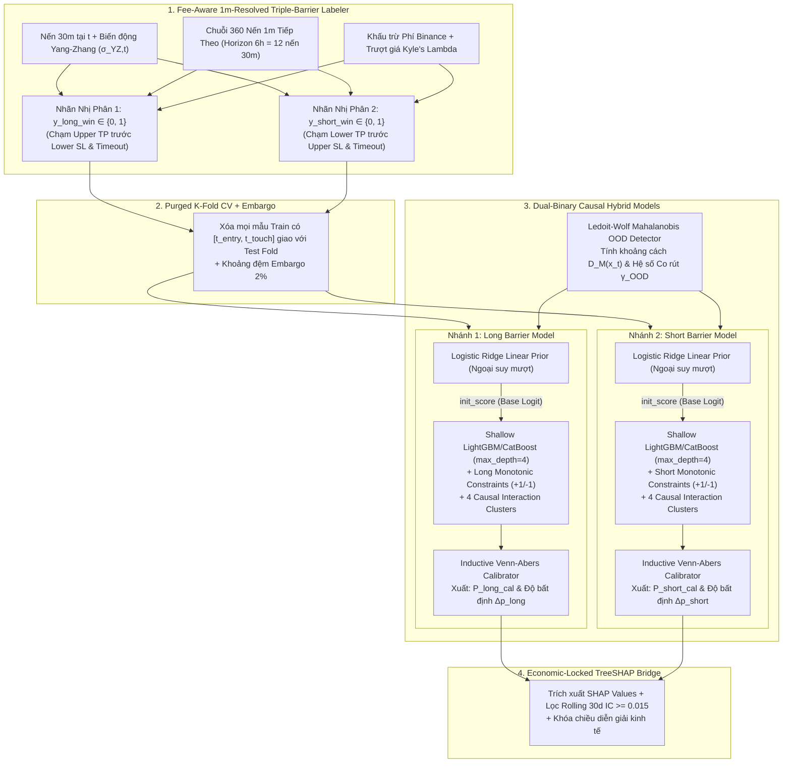

# 04 — Thiết Kế Mô Hình `Dual-Binary Causal ML`, `Triple-Barrier`, `Venn-Abers` & `Locked TreeSHAP`

> [!IMPORTANT]
> **Mục tiêu Pattern 4:** Giải quyết triệt để điểm yếu **"Chia nhánh giả tạo phi kinh tế (Spurious Splits)"** của cây quyết định truyền thống bằng kiến trúc **Dual-Binary Causal Meta-Models (`Long Barrier Model` & `Short Barrier Model` tách biệt)**. Kết hợp **Tầng cơ sở Tuyến tính (`Logistic Ridge Prior`) + Cây quyết định nông có khóa đơn điệu (`Monotonic & Interaction-Constrained LightGBM/CatBoost`)**, đi kèm bộ phát hiện lệch phân phối **`Mahalanobis OOD Detector`** và hiệu chuẩn xác suất có biên độ bất định **`Inductive Venn-Abers Calibration`**.

---

## 1. Sơ Đồ Kiến Trúc Huấn Luyện & Suy Luận `Dual-Binary Causal ML`



---

## 2. Tại Sao Phải Tách `Long Barrier Model` Và `Short Barrier Model`?

Nếu dùng 1 mô hình phân loại 3 lớp (`[Short, Neutral, Long]`), ta **bất khả thi** trong việc áp đặt ràng buộc đơn điệu kinh tế (`monotone_constraints`) cho các biến trạng thái đối xứng:
- **Ví dụ 1 (`Hurst Exponent` $H_t$):** Khi $H_t$ tăng từ `0.48` lên `0.65`, thị trường có xu hướng bền bỉ hơn $\rightarrow$ Xác suất giá đi một mạch chạm biên chốt lời (`TP`) **tăng lên cho CẢ kèo Long Breakout LẪN kèo Short Breakdown**!
- **Ví dụ 2 (`VPIN Toxicity`):** Khi `VPIN` tăng vọt lên vùng `> 0.85` (sổ lệnh hỗn loạn, nguy cơ quét râu nến 2 đầu), xác suất bị quét `SL` trước khi tới `TP` tăng lên cho cả 2 chiều $\rightarrow$ Tác động đơn điệu lên xác suất thắng ròng của cả Long và Short đều là **`-1`**.

Khi tách thành **2 mô hình nhị phân độc lập (`Long Model` & `Short Model`)**, toàn bộ bảng dấu đơn điệu và cụm tương tác nhân quả trở nên **nhất quán 100% về mặt kinh tế**:

| Tên Đặc Trưng (Feature) | Cụm Tương Tác Nhân Quả (`Interaction Cluster`) | Khóa Đơn Điệu Ở `Long Model` | Khóa Đơn Điệu Ở `Short Model` | Lý Giải Kinh Tế Bất Biến |
| :--- | :--- | :---: | :---: | :--- |
| `hurst_exponent_100` | `CLUSTER_0_REGIME` | `+1` | `+1` | Độ nhớ xu hướng cao giúp giá dễ đi hết biên độ tới TP hơn ở cả 2 chiều. |
| `shannon_entropy_50` | `CLUSTER_0_REGIME` | `-1` | `-1` | Độ nhiễu/hỗn loạn cao làm tăng xác suất giật cục quét SL ở cả 2 chiều. |
| `fracdiff_momentum_z` | `CLUSTER_0_REGIME` | `+1` | `-1` | Xung lượng giá có bộ nhớ dương ủng hộ Long (`+1`), phản đối Short (`-1`). |
| `vpin_toxicity_pct` | `CLUSTER_1_MICRO` | `-1` | `-1` | Độc tố dòng lệnh quá cao cảnh báo rủi ro quét thanh khoản (Adverse Selection). |
| `taker_cvd_z_24` | `CLUSTER_1_MICRO` | `+1` | `-1` | Dòng lệnh Market Buy chủ động áp đảo ủng hộ Long (`+1`), phản đối Short (`-1`). |
| `ofi_imbalance_z` | `CLUSTER_1_MICRO` | `+1` | `-1` | Áp lực đẩy giá từ sổ lệnh chờ nghiêng về phe mua. |
| `oi_directional_score` | `CLUSTER_2_DERIV` | `+1` | `-1` | Điểm hội tụ `OI Delta x Price Delta` dương (Long Build-up) ủng hộ Long. |
| `funding_crowded_pos_z` | `CLUSTER_2_DERIV` | `-1` | `+1` | Funding dương quá mức (`Z > +2.0`) báo hiệu Long quá tải, dễ bị Long Squeeze. |
| `funding_crowded_neg_z` | `CLUSTER_2_DERIV` | `+1` | `-1` | Funding âm quá mức (`Z < -2.0`) báo hiệu Short quá tải, dễ bị Short Squeeze. |
| `btc_lead_catchup_gap` | `CLUSTER_3_CROSS` | `+1` | `-1` | BTC đã chạy lên trước nhưng Altcoin chưa chạy kịp $\rightarrow$ Lực hút kéo Altcoin lên. |

---

## 3. Bộ Gán Nhãn `Fee-Aware 1m-Resolved Triple-Barrier Labeler` (`triple_barrier_labeler.py`)

Tại mỗi cây nến `30m` đóng tại thời điểm $t$ với giá đóng cửa $P_t$ và biến động thực $\sigma_{YZ, t}$:
1. **Định nghĩa độ rộng rào chắn động (Đã cộng bù Phí & Trượt giá):**
   - Gọi $c_t = 2 f_{\text{taker}} + 2 \hat{s}_t(\lambda_t)$ là chi phí khứ hồi ước tính tại thời điểm $t$.
   - Biên chốt lời yêu cầu lợi nhuận ròng tối thiểu gấp $m_{\text{pt}} = 2.2$ lần biến động chuẩn cộng chi phí; biên cắt lỗ đặt tại $m_{\text{sl}} = 1.2$ lần biến động chuẩn:
     $$\Delta_{\text{TP}, t} = \max\left(6 \cdot c_t, \; m_{\text{pt}} \cdot \sigma_{YZ, t} + c_t\right), \quad \Delta_{\text{SL}, t} = m_{\text{sl}} \cdot \sigma_{YZ, t}$$
2. **Quét Chuỗi `360` Cây Nến `1m` Tiếp Theo (Tương Đương `12` Nến `30m` = `6 Giờ`):**
   - Với **Nhãn Long (`y_long_win`)**:
     - Rào trên $U_{\text{long}} = P_t (1 + \Delta_{\text{TP}, t})$, rào dưới $L_{\text{long}} = P_t (1 - \Delta_{\text{SL}, t})$.
     - Duyệt từng phút $m = 1..360$: Nếu tại phút $m$, $H_{t+m}^{(1m)} \ge U_{\text{long}}$ xảy ra **trước** khi $L_{t+m}^{(1m)} \le L_{\text{long}}$, gán `y_long_win = 1`; ngược lại (chạm SL trước hoặc hết 360 phút chưa chạm TP) gán `y_long_win = 0`.
   - Với **Nhãn Short (`y_short_win`)**:
     - Rào dưới (Chốt lời Short) $L_{\text{short}} = P_t (1 - \Delta_{\text{TP}, t})$, rào trên (Cắt lỗ Short) $U_{\text{short}} = P_t (1 + \Delta_{\text{SL}, t})$.
     - Duyệt từng phút $m = 1..360$: Nếu $L_{t+m}^{(1m)} \le L_{\text{short}}$ xảy ra trước khi $H_{t+m}^{(1m)} \ge U_{\text{short}}$, gán `y_short_win = 1`; ngược lại gán `y_short_win = 0`.

---

## 4. Thuật Toán `Purged K-Fold CV`, `Mahalanobis OOD` & `Inductive Venn-Abers Calibration`

### 4.1. Code Triển Khai `MahalanobisOODDetector` & `InductiveVennAbersCalibrator`

```python
"""Bộ phát hiện lệch phân phối Mahalanobis & Hiệu chuẩn Venn-Abers (Không tham số mặc định, không hardcode)."""
from __future__ import annotations

from dataclasses import dataclass
import numpy as np
from scipy.stats import chi2
from sklearn.covariance import LedoitWolf
from sklearn.isotonic import IsotonicRegression


@dataclass
class OODDetectorConfig:
    alpha_quantile: float
    decay_rate: float


@dataclass
class VennAbersConfig:
    prob_clip_min: float
    prob_clip_max: float
    denom_eps: float


@dataclass
class CalibratedPrediction:
    p_calibrated: float
    p_lower: float
    p_upper: float
    uncertainty_width: float
    ood_mahalanobis_dist: float
    ood_shrinkage_factor: float
    is_ood_warning: bool


class MahalanobisOODDetector:
    """Phát hiện khi thị trường bước vào vùng biến động chưa từng xuất hiện trong tập Train."""

    def __init__(self, cfg: OODDetectorConfig) -> None:
        self.cfg = cfg
        self.mean_: np.ndarray | None
        self.precision_: np.ndarray | None
        self.threshold_dist_: float
        self.mean_ = None
        self.precision_ = None
        self.threshold_dist_ = 0.0

    def fit(self, X_train: np.ndarray) -> MahalanobisOODDetector:
        lw = LedoitWolf().fit(X_train)
        self.mean_ = lw.location_
        self.precision_ = lw.precision_
        dof = X_train.shape[1]
        self.threshold_dist_ = float(np.sqrt(chi2.ppf(self.cfg.alpha_quantile, df=dof)))
        return self

    def score_and_shrinkage(self, x_vec: np.ndarray) -> tuple[float, float, bool]:
        if self.mean_ is None or self.precision_ is None or self.threshold_dist_ <= 0.0:
            raise RuntimeError("MahalanobisOODDetector chưa được huấn luyện (fit).")
        diff = x_vec - self.mean_
        dist_sq = float(diff.T @ self.precision_ @ diff)
        dist = float(np.sqrt(max(0.0, dist_sq)))
        is_ood = dist > self.threshold_dist_
        if not is_ood:
            return dist, 1.0, False
        excess = (dist - self.threshold_dist_) / self.threshold_dist_
        shrinkage = float(np.exp(-self.cfg.decay_rate * excess))
        return dist, shrinkage, True


class InductiveVennAbersCalibrator:
    """Hiệu chuẩn xác suất nhị phân xuất kèm biên độ bất định [p_0, p_1] (Vovk & Petej, 2014)."""

    def __init__(self, cfg: VennAbersConfig) -> None:
        self.cfg = cfg
        self.cal_scores_: np.ndarray | None
        self.cal_labels_: np.ndarray | None
        self.cal_scores_ = None
        self.cal_labels_ = None

    def fit(self, raw_scores: np.ndarray, y_true: np.ndarray) -> InductiveVennAbersCalibrator:
        self.cal_scores_ = np.asarray(raw_scores, dtype=np.float64)
        self.cal_labels_ = np.asarray(y_true, dtype=np.float64)
        return self

    def predict_with_uncertainty(self, test_score: float) -> tuple[float, float, float, float]:
        if self.cal_scores_ is None or self.cal_labels_ is None:
            raise RuntimeError("InductiveVennAbersCalibrator chưa được fit dữ liệu calibration.")
        s_aug = np.append(self.cal_scores_, test_score)
        p_min = self.cfg.prob_clip_min
        p_max = self.cfg.prob_clip_max

        y_aug_0 = np.append(self.cal_labels_, 0.0)
        iso_0 = IsotonicRegression(out_of_bounds="clip", y_min=p_min, y_max=p_max)
        p0 = float(iso_0.fit(s_aug, y_aug_0).predict([test_score])[0])

        y_aug_1 = np.append(self.cal_labels_, 1.0)
        iso_1 = IsotonicRegression(out_of_bounds="clip", y_min=p_min, y_max=p_max)
        p1 = float(iso_1.fit(s_aug, y_aug_1).predict([test_score])[0])

        denom = 1.0 - p0 + p1
        if denom <= self.cfg.denom_eps:
            raise ValueError(f"Venn-Abers denominator suy biến: p0={p0}, p1={p1}")
        p_cal = float(p1 / denom)
        width = abs(p1 - p0)
        return p_cal, min(p0, p1), max(p0, p1), width
```

---

## 5. Mô Hình Lai `Linear Ridge Prior + Monotonic Constrained LightGBM` (`dual_binary_gbdt.py`)

```python
"""Dual-Binary Causal Model: Cấu hình tường minh 100% từ CausalGBDTConfig (Zero Hardcode)."""
from __future__ import annotations

from dataclasses import dataclass
import lightgbm as lgb
import numpy as np
from scipy.special import expit, logit
from sklearn.linear_model import LogisticRegression


@dataclass
class CausalGBDTConfig:
    ridge_c: float
    ridge_max_iter: int
    prior_prob_clip_min: float
    prior_prob_clip_max: float
    prior_logit_blend_weight: float
    max_depth: int
    num_leaves: int
    min_child_samples: int
    learning_rate: float
    subsample: float
    colsample_bytree: float
    reg_alpha: float
    reg_lambda: float
    num_boost_round: int
    early_stopping_rounds: int


class CausalBinaryBarrierModel:
    def __init__(
        self,
        cfg: CausalGBDTConfig,
        feature_names: list[str],
        monotone_constraints: list[int],
        interaction_groups: list[list[int]],
    ) -> None:
        self.cfg = cfg
        self.feature_names = feature_names
        self.monotone_constraints = monotone_constraints
        self.interaction_groups = interaction_groups
        self.linear_prior = LogisticRegression(
            penalty="l2",
            C=cfg.ridge_c,
            solver="lbfgs",
            max_iter=cfg.ridge_max_iter,
        )
        self.booster_: lgb.Booster | None
        self.booster_ = None

    def fit(self, X_train: np.ndarray, y_train: np.ndarray, X_val: np.ndarray, y_val: np.ndarray) -> None:
        self.linear_prior.fit(X_train, y_train)
        c_min = self.cfg.prior_prob_clip_min
        c_max = self.cfg.prior_prob_clip_max
        w_prior = self.cfg.prior_logit_blend_weight

        train_prior_prob = np.clip(self.linear_prior.predict_proba(X_train)[:, 1], c_min, c_max)
        val_prior_prob = np.clip(self.linear_prior.predict_proba(X_val)[:, 1], c_min, c_max)

        train_init_margin = w_prior * logit(train_prior_prob)
        val_init_margin = w_prior * logit(val_prior_prob)

        dtrain = lgb.Dataset(X_train, label=y_train, init_score=train_init_margin, feature_name=self.feature_names)
        dval = lgb.Dataset(
            X_val, label=y_val, init_score=val_init_margin, reference=dtrain, feature_name=self.feature_names
        )

        params = {
            "objective": "binary",
            "metric": "binary_logloss",
            "boosting_type": "gbdt",
            "max_depth": self.cfg.max_depth,
            "num_leaves": self.cfg.num_leaves,
            "min_child_samples": self.cfg.min_child_samples,
            "learning_rate": self.cfg.learning_rate,
            "subsample": self.cfg.subsample,
            "colsample_bytree": self.cfg.colsample_bytree,
            "reg_alpha": self.cfg.reg_alpha,
            "reg_lambda": self.cfg.reg_lambda,
            "monotone_constraints": self.monotone_constraints,
            "monotone_constraints_method": "advanced",
            "interaction_constraints": self.interaction_groups,
            "verbose": -1,
        }

        self.booster_ = lgb.train(
            params,
            dtrain,
            num_boost_round=self.cfg.num_boost_round,
            valid_sets=[dval],
            callbacks=[lgb.early_stopping(stopping_rounds=self.cfg.early_stopping_rounds, verbose=False)],
        )

    def predict_raw_prob(self, X: np.ndarray) -> np.ndarray:
        if self.booster_ is None:
            raise RuntimeError("CausalBinaryBarrierModel chưa được fit.")
        c_min = self.cfg.prior_prob_clip_min
        c_max = self.cfg.prior_prob_clip_max
        prior_prob = np.clip(self.linear_prior.predict_proba(X)[:, 1], c_min, c_max)
        init_margin = self.cfg.prior_logit_blend_weight * logit(prior_prob)
        tree_margin = self.booster_.predict(X, raw_score=True)
        return expit(init_margin + tree_margin)
```

---

## 6. Checklist Nghiệm Thu Stage 3 (`Doc 04`)

- [ ] Kiểm thử `Fee-Aware 1m Triple-Barrier Labeler` đảm bảo các trường hợp râu nến chạm cả `TP` và `SL` trong cùng 1 cây nến `30m` đều được phân xử chính xác bằng dữ liệu `1m`.
- [ ] Kiểm thử `PurgedKFold` đảm bảo `0` mẫu dữ liệu nào giữa tập Train và Validation bị chồng lấn khoảng thời gian giữ lệnh `[t_entry, t_barrier_touch]`.
- [ ] Chạy `tests/unit/test_causal_ml_monotonicity.py`: Tăng biến có `monotone_prior = +1` (giữ nguyên các biến khác) và xác nhận xác suất dự báo của `CausalBinaryBarrierModel` **tăng đơn điệu 100%** không bao giờ bị gãy khúc zích-zắc.
