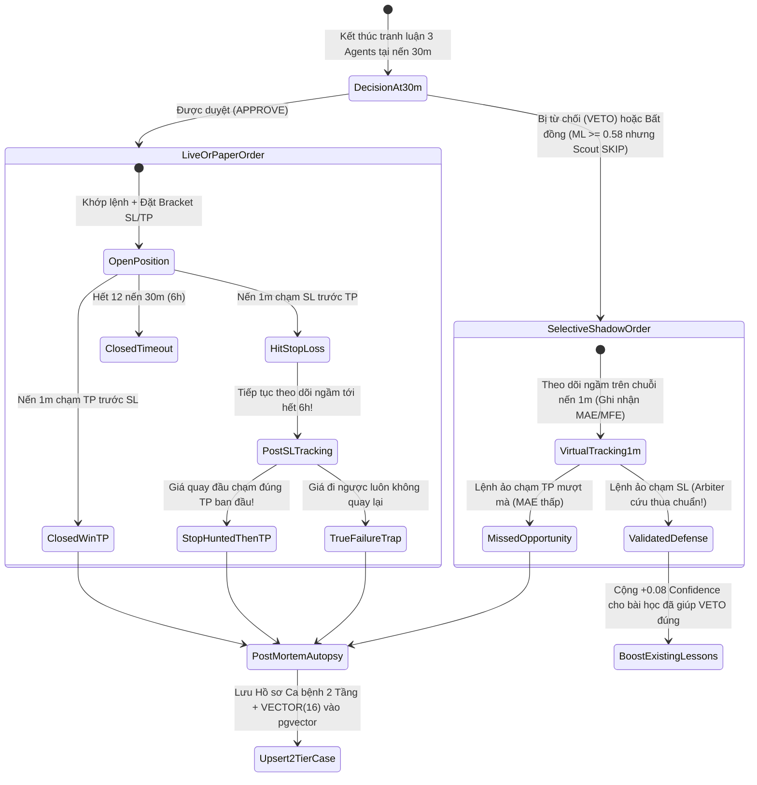
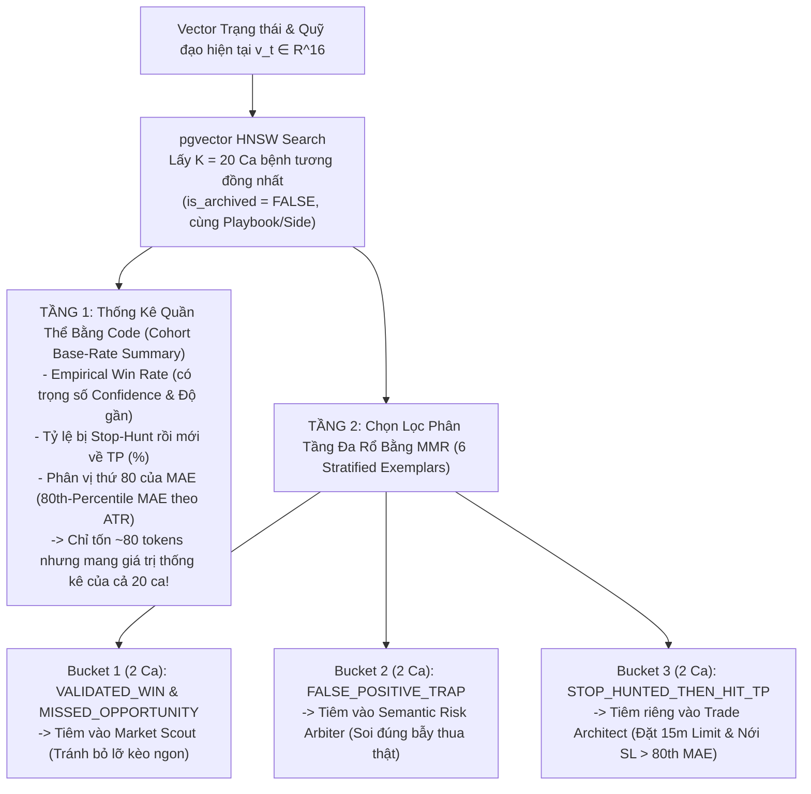

# 06 — Thiết Kế Lệnh Ảo `Selective Shadow Orders` & Bộ Nhớ Kép `k-NN Cohort (K=20) + 6 Stratified Multi-Bucket Lessons` Trên `pgvector`

> [!IMPORTANT]
> **Mục tiêu Pattern 6:** Xây dựng cơ chế học phản thực tế (**Counterfactual Learning**) từ cả **Lệnh thua (`Failures`)** và **Cơ hội bị bỏ lỡ (`Missed Opportunities`)** thông qua Lệnh ảo (`Shadow Orders`) và theo dõi đường giá hậu SL (`Post-SL Path Tracking`). Đặc biệt, giải quyết triệt để rủi ro **"Thiên kiến giai thoại mẫu đơn (`Single-Sample Anecdotal Bias`)"** bằng kiến trúc truy xuất 2 tầng trên `pgvector`: **(1) Lấy rộng Quần thể `K = 20` ca tương đồng nhất để tính Thống kê Xác suất Thực nghiệm (`Cohort Base-Rate & 80th-Percentile MAE`)**, và **(2) Lọc Phân tầng `6 Bài học Đại diện (`2 Bull/Missed + 2 Failure Traps + 2 Execution/Stop-Hunt`)`** chuyển về đúng từng Agent.

---

## 1. Sơ Đồ Vòng Đời Lệnh Thật, Lệnh Ảo (`Shadow Orders`) & Giải Phẫu Hậu SL



---

## 2. Thiết Kế Vector Trạng Thái & Quỹ Đạo 16 Chiều (`VECTOR(16)` — 0 Tốn API)

Mỗi ca giao dịch (thật hoặc ảo) được mã hóa thành một vector toán học chuẩn hóa 16 chiều $\mathbf{v} \in \mathbb{R}^{16}$ kết hợp cả **Trạng thái tĩnh lúc vào lệnh (`Static Regime`)** và **Quỹ đạo động lực học 3 nến trước đó (`3-Bar Temporal Trajectory`)**:

```python
"""Bộ tạo Vector Trạng thái & Quỹ đạo 16 chiều cho pgvector (src/infrastructure/persistence/pgvector_memory_repo.py)."""
from __future__ import annotations

import numpy as np


def build_16d_regime_trajectory_vector(
    # 1. Trạng thái tĩnh tại nến t (Static Regime Snapshot - 8 chiều)
    hurst_z: float,
    yang_zhang_vol_z: float,
    shannon_entropy_z: float,
    vpin_z: float,
    obi_mean_z: float,
    taker_cvd_z: float,
    oi_directional_score_z: float,
    funding_rate_z: float,
    # 2. Quỹ đạo biến thiên 3 nến gần nhất t-3 -> t (Temporal Trajectory - 5 chiều)
    vpin_slope_3bars_z: float,
    oi_acceleration_3bars_z: float,
    cvd_acceleration_3bars_z: float,
    fracdiff_momentum_slope_z: float,
    volatility_expansion_ratio_z: float,
    # 3. Bối cảnh dẫn dắt chéo & Phiên giao dịch (Cross-Asset & Session - 3 chiều)
    btc_15m_return_z: float,
    lead_lag_catchup_gap_z: float,
    session_liquidity_score: float,  # -1.0 (Asia thấp), 0.0 (EU), +1.0 (US Open biến động cao)
) -> list[float]:
    raw = np.array(
        [
            hurst_z,
            yang_zhang_vol_z,
            shannon_entropy_z,
            vpin_z,
            obi_mean_z,
            taker_cvd_z,
            oi_directional_score_z,
            funding_rate_z,
            vpin_slope_3bars_z,
            oi_acceleration_3bars_z,
            cvd_acceleration_3bars_z,
            fracdiff_momentum_slope_z,
            volatility_expansion_ratio_z,
            btc_15m_return_z,
            lead_lag_catchup_gap_z,
            session_liquidity_score,
        ],
        dtype=np.float64,
    )
    # Kẹp biên [-4.0, +4.0] bằng hàm tanh mềm để chống nhiễu ngoại lai làm lệch khoảng cách L2
    squashed = 4.0 * np.tanh(raw / 4.0)
    return [round(float(x), 5) for x in squashed]
```

---

## 3. Kiến Trúc Truy Xuất Kép: `k-NN Cohort (K=20)` + `6 Stratified Multi-Bucket Lessons`

### 3.1. Tại Sao Phải Kết Hợp Cả `K=20 Cohort Stats` Lẫn `6 Stratified Lessons`?



### 3.2. Code Triển Khai Bộ Truy Xuất `CohortAndStratifiedMemoryRetriever` (`pgvector_memory_repo.py`)

```python
"""Truy xuất Quần thể K=20 Ca bệnh + Chọn lọc Phân tầng 6 Bài học trên pgvector (Zero Fake Fallback)."""
from __future__ import annotations

from dataclasses import dataclass
import math
import numpy as np


@dataclass
class CohortRetrieverConfig:
    dist_decay_lambda: float
    mae_quantile_pct: float
    high_mae_Lesson_threshold_atr: float
    bucket_max_items: int
    weight_eps: float


@dataclass
class CohortBaseRateSummary:
    has_historical_cohort: bool
    total_neighbors: int
    weighted_win_rate: float | None
    stop_hunted_then_tp_rate: float | None
    true_failure_trap_rate: float | None
    expected_r_multiple: float | None
    mae_target_percentile_atr: float | None
    mfe_median_atr: float | None


@dataclass
class StratifiedMemoryPack:
    cohort_summary: CohortBaseRateSummary
    scout_bull_and_missed_lessons: list[dict]
    architect_execution_sl_lessons: list[dict]
    arbiter_failure_trap_lessons: list[dict]


def compute_cohort_summary_and_stratified_buckets(
    neighbors: list[dict],
    cfg: CohortRetrieverConfig,
) -> StratifiedMemoryPack:
    """
    `neighbors`: Danh sách K=20 bản ghi trả về từ câu lệnh SQL pgvector.
    Nếu kho bộ nhớ chưa có ca tương đồng nào, trả về `has_historical_cohort = False` và `None` tường minh
    (Tuyệt đối không bịa số giả kiểu 0.50 hay 1.25!).
    """
    if not neighbors:
        empty_summary = CohortBaseRateSummary(
            has_historical_cohort=False,
            total_neighbors=0,
            weighted_win_rate=None,
            stop_hunted_then_tp_rate=None,
            true_failure_trap_rate=None,
            expected_r_multiple=None,
            mae_target_percentile_atr=None,
            mfe_median_atr=None,
        )
        return StratifiedMemoryPack(empty_summary, [], [], [])

    weights = np.array(
        [
            math.exp(-cfg.dist_decay_lambda * float(row["l2_dist"])) * float(row["confidence_score"])
            for row in neighbors
        ],
        dtype=np.float64,
    )
    w_sum = float(np.sum(weights)) + cfg.weight_eps
    norm_w = weights / w_sum

    win_mask = np.array(
        [float(r["outcome_category"] in {"VALIDATED_WIN", "MISSED_OPPORTUNITY"}) for r in neighbors]
    )
    stophunt_mask = np.array(
        [float(r["outcome_category"] == "STOP_HUNTED_THEN_HIT_TP") for r in neighbors]
    )
    trap_mask = np.array(
        [float(r["outcome_category"] in {"FALSE_POSITIVE_TRAP", "VALIDATED_DEFENSE"}) for r in neighbors]
    )

    r_multiples = np.array([float(r["realized_r_multiple"]) for r in neighbors])
    mae_atrs = np.array([abs(float(r["mae_atr_multiple"])) for r in neighbors])
    mfe_atrs = np.array([abs(float(r["mfe_atr_multiple"])) for r in neighbors])

    summary = CohortBaseRateSummary(
        has_historical_cohort=True,
        total_neighbors=len(neighbors),
        weighted_win_rate=round(float(np.sum(norm_w * win_mask)), 3),
        stop_hunted_then_tp_rate=round(float(np.sum(norm_w * stophunt_mask)), 3),
        true_failure_trap_rate=round(float(np.sum(norm_w * trap_mask)), 3),
        expected_r_multiple=round(float(np.sum(norm_w * r_multiples)), 3),
        mae_target_percentile_atr=round(float(np.percentile(mae_atrs, cfg.mae_quantile_pct)), 2),
        mfe_median_atr=round(float(np.median(mfe_atrs)), 2),
    )

    max_k = cfg.bucket_max_items
    bucket_scout = [
        r["tier_2_dossier_json"]
        for r in neighbors
        if r["outcome_category"] in {"MISSED_OPPORTUNITY", "VALIDATED_WIN"}
    ][:max_k]

    bucket_architect = [
        r["tier_2_dossier_json"]
        for r in neighbors
        if (
            r["outcome_category"] == "STOP_HUNTED_THEN_HIT_TP"
            or abs(float(r["mae_atr_multiple"])) >= cfg.high_mae_Lesson_threshold_atr
        )
    ][:max_k]

    bucket_arbiter = [
        r["tier_2_dossier_json"]
        for r in neighbors
        if r["outcome_category"] in {"FALSE_POSITIVE_TRAP", "VALIDATED_DEFENSE"}
    ][:max_k]

    return StratifiedMemoryPack(
        cohort_summary=summary,
        scout_bull_and_missed_lessons=bucket_scout,
        architect_execution_sl_lessons=bucket_architect,
        arbiter_failure_trap_lessons=bucket_arbiter,
    )
```

---

## 4. Cơ Chế Giải Phẫu Hậu Kiểm (`Post-Mortem Autopsy Judge`) & Tự Thanh Lọc Điểm Uy Tín

1. **Khi nào tạo Bài học mới (`EpisodicCase`)?**
   - Hệ thống **không tạo bài học văn bản rác** nếu lệnh đóng do hết giờ (`STATISTICAL_NOISE_TIMEOUT`) với biên độ dao động nhỏ.
   - Chỉ gọi `Post-Mortem Judge Agent` để viết `tier_2_dossier_json` khi thuộc 1 trong 4 trường hợp:
     - `FALSE_POSITIVE_TRAP`: Lệnh thật chạm SL và tiếp tục đi ngược chiều mạnh.
     - `STOP_HUNTED_THEN_HIT_TP`: Lệnh thật chạm SL nhưng trong vòng `6h` đó giá quay đầu chạy thẳng tới mức `TP` ban đầu!
     - `MISSED_OPPORTUNITY`: Lệnh ảo (`Shadow Order`) chạm `TP` ngọt ngào với `MAE < 0.7x SL` **VÀ `veto_category == "SETUP_DEFECT"`**.
       - **Quy tắc Miễn trừ Ngữ cảnh Tài khoản (`Portfolio Capacity Veto Exemption`):** Nếu một Lệnh ảo bị `Risk Arbiter` hoặc `DeterministicRiskCalculator` từ chối với lý do **`veto_category == "PORTFOLIO_CAPACITY_VETO"`** (tức bản thân setup kỹ thuật tốt nhưng lúc đó tài khoản đã đầy Margin, chạm trần `effective_open_heat_pct`, hoặc đang bị khóa do sát ngưỡng Drawdown ngày), thì ngay cả khi Lệnh ảo đó về `TP`, hệ thống ghi nhận trạng thái là `CAPACITY_SKIPPED_WIN` chứ **tuyệt đối không gán nhãn `MISSED_OPPORTUNITY` và không trừ điểm `confidence_score` (`-0.12`) của các bài học đã dùng**! Điều này bảo vệ bộ nhớ `pgvector` không bị nhiễu bởi giới hạn vốn của tài khoản tại thời điểm quá khứ.
     - `VALIDATED_WIN` xuất sắc (`MFE >= 2.5x ATR`).
2. **Cơ chế Tiến hóa & Đào thải Điểm Uy Tín (`Confidence Score Evolution`):**
   - Khởi tạo `confidence_score = 0.55`.
   - Khi một ca bệnh nằm trong nhóm 6 bài học được trích xuất vào Prompt của chu kỳ hiện tại:
     - Nếu quyết định của đội Agents đem lại kết quả đúng (`VALIDATED_WIN` hoặc `VALIDATED_DEFENSE` né được lệnh thua): các bài học cùng chiều được cộng **`+0.08`** (tối đa `0.95`).
     - Nếu bài học cảnh báo làm `Risk Arbiter` VETO nhầm một kèo mà sau đó Lệnh ảo báo `MISSED_OPPORTUNITY`: bài học đó bị phạt **`-0.12`**.
     - Nếu `confidence_score < 0.25`: tự động đánh dấu `is_archived = TRUE` để loại khỏi chỉ mục tìm kiếm `pgvector`.

---

## 5. Checklist Nghiệm Thu Stage 5A (`Doc 06`)

- [ ] Viết Unit Test `test_cohort_memory_and_autopsy.py` kiểm tra một lệnh thật chạm SL ở phút thứ 15 nhưng đến phút thứ 90 giá tăng vọt qua mức TP ban đầu $\rightarrow$ xác nhận trạng thái chuyển đúng thành `STOP_HUNTED_THEN_HIT_TP` và tạo bài học cho `Trade Architect` mà không phạt `Scout`.
- [ ] Kiểm thử truy vấn `pgvector` với 20 ca giả lập có tỷ lệ thắng 75% nhưng ca gần nhất (`Top-1`) là ca thua $\rightarrow$ xác nhận `CohortBaseRateSummary` vẫn báo đúng `weighted_win_rate ~ 0.75` giúp đội Agents không bị đánh lừa bởi 1 ca đơn lẻ.
