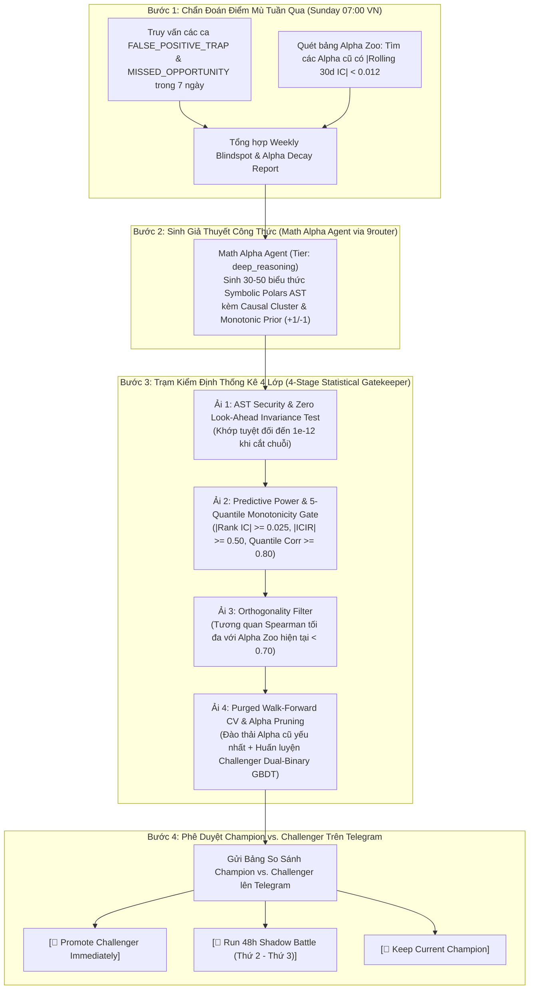

# 07 — Thiết Kế `Weekend Math Alpha Agent`, `4-Stage Statistical Gatekeeper` & Vòng Lặp `Champion vs. Challenger`

> [!IMPORTANT]
> **Mục tiêu Pattern 7:** Tự động hóa quá trình tiến hóa định lượng vào mỗi cuối tuần: `Math Alpha Agent` đọc báo cáo các điểm mù trong tuần (`Failures` & `Missed Opportunities` + các Alpha cũ bị suy thoái `IC Decay`), sinh ra 30–50 công thức **`Symbolic Polars AST`** có giả thuyết kinh tế rõ ràng, sàng lọc qua **Trạm Kiểm Định Thống Kê 4 Lớp (bao gồm Kiểm định Đơn điệu 5 Phân vị `5-Quantile Monotonicity Check`)**, huấn luyện mô hình `Challenger` và gửi báo cáo so sánh trực tiếp với `Champion` lên Telegram để phê duyệt.

---

## 1. Sơ Đồ Quy Trình Đào Alpha & Huấn Luyện Lại Mỗi Cuối Tuần



---

## 2. Cấu Trúc Đề Xuất Của `Math Alpha Agent` (`src/infrastructure/agents/math_alpha_agent.py`)

`Math Alpha Agent` không được sinh công thức ngẫu nhiên vô nghĩa, mà bắt buộc phải điền đầy đủ Schema **`SymbolicAlphaCandidate`** cho mỗi công thức:

```python
from pydantic import BaseModel, Field


class SymbolicAlphaCandidate(BaseModel):
    alpha_id: str = Field(description="Tên định danh ngắn gọn, ví dụ: wq_micro_exhaustion_01")
    dsl_expression: str = Field(
        description="Biểu thức hợp lệ trong tập toán tử Symbolic Polars AST, ví dụ: "
        "tanh_norm(ts_zscore(ofi_sum, 16) - ts_zscore(vpin, 16))"
    )
    causal_cluster: str = Field(
        description="Thuộc 1 trong 4 cụm: CLUSTER_0_REGIME, CLUSTER_1_MICRO, CLUSTER_2_DERIV, CLUSTER_3_CROSS"
    )
    long_monotonic_prior: int = Field(ge=-1, le=1, description="+1 nếu giá trị cao ủng hộ Long, -1 nếu phản đối")
    short_monotonic_prior: int = Field(ge=-1, le=1, description="+1 nếu giá trị cao ủng hộ Short, -1 nếu phản đối")
    targeted_blindspot: str = Field(description="Giải thích công thức này khắc phục lỗi nào của tuần qua")
    economic_rationale: str = Field(description="Cơ chế vi cấu trúc hoặc hành vi thị trường đằng sau công thức")
```

---

## 3. Đặc Tả Toán Học & Code Của `4-Stage Statistical Gatekeeper`

### 3.1. Tại Sao Phải Có Kiểm Định Đơn Điệu 5 Phân Vị (`5-Quantile Monotonicity Check`) Ở Ải 2?

Một công thức Alpha giả tạo có thể đạt `Rank IC = 0.03` chỉ nhờ một vài điểm ngoại lai ở 2 đầu phân phối, trong khi ở giữa phân phối thì lợi nhuận kỳ vọng nhảy loạn xạ (ví dụ: Phân vị 1 lỗ `-0.2%`, Phân vị 2 lãi `+0.5%`, Phân vị 3 lỗ `-0.4%`, Phân vị 4 lỗ `-0.1%`, Phân vị 5 lãi `+0.6%`). Nếu đưa một biến như vậy vào mô hình có khóa đơn điệu (`monotone_constraints`), nó sẽ làm méo mó ranh giới phân lớp!

Do đó, **Ải 2** bắt buộc chia giá trị của Alpha trên tập Out-of-Sample thành **5 Nhóm Phân Vị Bằng Nhau (`Q1, Q2, Q3, Q4, Q5`)**:
- Gọi $\bar{y}_{Q_k}$ là tỷ lệ chạm biên thắng ròng trung bình trong phân vị thứ $k \in \{1, 2, 3, 4, 5\}$.
- Tính hệ số tương quan hạng Spearman giữa chỉ số phân vị $[1, 2, 3, 4, 5]$ và $[\bar{y}_{Q_1}, \bar{y}_{Q_2}, \bar{y}_{Q_3}, \bar{y}_{Q_4}, \bar{y}_{Q_5}]$:
  $$\rho_{\text{mono}} = \text{SpearmanCorr}\left([1, 2, 3, 4, 5], \; [\bar{y}_{Q_1}, \bar{y}_{Q_2}, \bar{y}_{Q_3}, \bar{y}_{Q_4}, \bar{y}_{Q_5}]\right)$$
- **Điều kiện vượt Ải 2:** $|\rho_{\text{mono}}| \ge 0.80$ **VÀ** dấu của $\rho_{\text{mono}}$ phải khớp đúng 100% với `long_monotonic_prior` / `short_monotonic_prior` mà `Math Agent` đã tuyên bố!

### 3.2. Code Triển Khai `StatisticalAlphaGatekeeper`

```python
"""Trạm kiểm định thống kê 4 lớp cho các công thức Symbolic Alpha mới (Zero Default, Zero Silent Fallback)."""
from __future__ import annotations

from dataclasses import dataclass
import numpy as np
from scipy.stats import spearmanr


@dataclass
class AlphaGatekeeperConfig:
    min_valid_sample_ratio: float
    min_series_std: float
    invariance_tol: float
    min_abs_rank_ic: float
    min_abs_icir: float
    min_daily_blocks_for_icir: int
    daily_block_bars: int
    min_quantile_monotonicity: float
    max_collinearity_corr: float


@dataclass
class AlphaGateResult:
    alpha_id: str
    passed_all_gates: bool
    failed_stage: str | None
    oos_rank_ic: float
    oos_icir: float
    quantile_monotonicity_corr: float
    max_corr_with_existing: float


class StatisticalAlphaGatekeeper:
    def __init__(self, cfg: AlphaGatekeeperConfig) -> None:
        self.cfg = cfg

    def evaluate_candidate(
        self,
        alpha_id: str,
        alpha_oos_series: np.ndarray,
        alpha_truncated_series: np.ndarray,
        target_returns_oos: np.ndarray,
        expected_monotonic_sign: int,
        existing_alpha_matrix_oos: np.ndarray,
    ) -> AlphaGateResult:
        # --- ẢI 1: Kiểm tra Bất biến Thời gian (No Look-Ahead) & Tỷ lệ NaN ---
        n_trunc = len(alpha_truncated_series)
        tol = self.cfg.invariance_tol
        if not np.allclose(
            alpha_oos_series[:n_trunc], alpha_truncated_series, rtol=tol, atol=tol, equal_nan=True
        ):
            return AlphaGateResult(alpha_id, False, "STAGE_1_LOOKAHEAD_VIOLATION", 0.0, 0.0, 0.0, 0.0)

        valid_mask = ~np.isnan(alpha_oos_series) & ~np.isnan(target_returns_oos)
        if (
            np.mean(valid_mask) < self.cfg.min_valid_sample_ratio
            or np.std(alpha_oos_series[valid_mask]) < self.cfg.min_series_std
        ):
            return AlphaGateResult(alpha_id, False, "STAGE_1_DEGENERATE_OR_EXCESS_NAN", 0.0, 0.0, 0.0, 0.0)

        a_valid = alpha_oos_series[valid_mask]
        y_valid = target_returns_oos[valid_mask]

        # --- ẢI 2: Kiểm tra Rank IC, ICIR và Đơn điệu 5 Phân vị (5-Quantile Monotonicity) ---
        raw_ic, _ = spearmanr(a_valid, y_valid)
        if np.isnan(raw_ic):
            return AlphaGateResult(alpha_id, False, "STAGE_2_NAN_SPEARMAN_IC", 0.0, 0.0, 0.0, 0.0)
        overall_ic = float(raw_ic)

        block_size = self.cfg.daily_block_bars
        num_blocks = len(a_valid) // block_size
        daily_ics: list[float] = []
        for b in range(num_blocks):
            sub_a = a_valid[b * block_size : (b + 1) * block_size]
            sub_y = y_valid[b * block_size : (b + 1) * block_size]
            if np.std(sub_a) > self.cfg.min_series_std and np.std(sub_y) > self.cfg.min_series_std:
                ic_b, _ = spearmanr(sub_a, sub_y)
                if not np.isnan(ic_b):
                    daily_ics.append(float(ic_b))

        if len(daily_ics) < self.cfg.min_daily_blocks_for_icir:
            return AlphaGateResult(alpha_id, False, "STAGE_2_INSUFFICIENT_DAILY_BLOCKS", overall_ic, 0.0, 0.0, 0.0)

        ic_std = float(np.std(daily_ics))
        icir = float(np.mean(daily_ics) / (ic_std + self.cfg.min_series_std))

        # Chia 5 Quantiles kiểm tra tính đơn điệu
        quantiles = np.quantile(a_valid, [0.0, 0.2, 0.4, 0.6, 0.8, 1.0])
        q_means: list[float] = []
        for q_idx in range(5):
            low, high = quantiles[q_idx], quantiles[q_idx + 1]
            if q_idx == 4:
                mask_q = (a_valid >= low) & (a_valid <= high)
            else:
                mask_q = (a_valid >= low) & (a_valid < high)
            if not np.any(mask_q):
                return AlphaGateResult(alpha_id, False, "STAGE_2_EMPTY_QUANTILE_BUCKET", overall_ic, icir, 0.0, 0.0)
            q_means.append(float(np.mean(y_valid[mask_q])))

        raw_mono_corr, _ = spearmanr([1, 2, 3, 4, 5], q_means)
        if np.isnan(raw_mono_corr):
            return AlphaGateResult(alpha_id, False, "STAGE_2_NAN_MONOTONICITY", overall_ic, icir, 0.0, 0.0)
        mono_corr = float(raw_mono_corr)

        if abs(overall_ic) < self.cfg.min_abs_rank_ic or abs(icir) < self.cfg.min_abs_icir:
            return AlphaGateResult(
                alpha_id, False, "STAGE_2_WEAK_IC_OR_ICIR", overall_ic, icir, mono_corr, 0.0
            )

        if (
            abs(mono_corr) < self.cfg.min_quantile_monotonicity
            or np.sign(mono_corr) != np.sign(expected_monotonic_sign)
        ):
            return AlphaGateResult(
                alpha_id, False, "STAGE_2_NON_MONOTONIC_QUANTILES", overall_ic, icir, mono_corr, 0.0
            )

        # --- ẢI 3: Kiểm tra Độ độc lập (Orthogonality với các Alpha hiện có) ---
        max_corr = 0.0
        if existing_alpha_matrix_oos.size > 0:
            for col_idx in range(existing_alpha_matrix_oos.shape[1]):
                ex_col = existing_alpha_matrix_oos[valid_mask, col_idx]
                c_val, _ = spearmanr(a_valid, ex_col)
                if not np.isnan(c_val):
                    max_corr = max(max_corr, abs(float(c_val)))

        if max_corr >= self.cfg.max_collinearity_corr:
            return AlphaGateResult(
                alpha_id, False, "STAGE_3_COLLINEAR_DUPLICATE", overall_ic, icir, mono_corr, max_corr
            )

        return AlphaGateResult(
            alpha_id=alpha_id,
            passed_all_gates=True,
            failed_stage=None,
            oos_rank_ic=round(overall_ic, 4),
            oos_icir=round(icir, 3),
            quantile_monotonicity_corr=round(mono_corr, 3),
            max_corr_with_existing=round(max_corr, 3),
        )
```

---

## 4. Cơ Chế `Alpha Pruning` & Đấu Trường `48h Shadow Battle` (`Champion vs. Challenger`)

1. **Cắt tỉa Alpha cũ suy thoái (`Alpha Pruning`):**
   - Để tránh "Lời nguyền chiều dữ liệu" (*Curse of Dimensionality*), tổng số features trong `Dual-Binary Causal GBDT` luôn được giới hạn ở **`35 – 50 features`**.
   - Mỗi khi thêm $M$ Alpha mới vượt qua 3 ải đầu, hệ thống tự động loại bỏ tối đa $M$ Alpha thuộc nhóm `WEEKEND_MATH_AGENT` cũ đang có `|Rolling 30d IC| < 0.012` và đứng cuối bảng đóng góp `SHAP`.
2. **Chế độ `48h Shadow Battle` khi bạn bấm nút trên Telegram:**
   - Nếu vào tối Chủ Nhật bạn chọn **`[👻 Run 48h Shadow Battle]`**:
     - Trong suốt Thứ Hai và Thứ Ba (96 cây nến `30m`), mô hình `Champion` vẫn phục vụ giao dịch chính, đồng thời mô hình `Challenger` chạy ngầm song song và ghi nhận điểm **`Real-time Brier Skill Score`** + lợi nhuận giả lập sau phí.
     - Đúng 07:00 sáng Thứ Tư, nếu `Challenger` có `Brier Loss` thấp hơn và `Net Expectancy` cao hơn `Champion`, hệ thống tự động thăng hạng (`Hot-Swap`) `Challenger` lên làm `Champion` chính thức và thông báo qua Telegram!

---

## 5. Checklist Nghiệm Thu Stage 5B (`Doc 07`)

- [ ] Kiểm thử `StatisticalAlphaGatekeeper` với 3 loại Alpha giả lập: (1) Alpha có nhìn trước tương lai $\rightarrow$ bị chặn ở `STAGE_1`, (2) Alpha có đồ thị lợi nhuận hình chữ U $\rightarrow$ bị chặn ở `STAGE_2_NON_MONOTONIC_QUANTILES`, (3) Alpha trùng lặp 85% với Alpha cũ $\rightarrow$ bị chặn ở `STAGE_3_COLLINEAR_DUPLICATE`.
- [ ] Kiểm thử luồng tạo báo cáo `Champion vs. Challenger` và gửi tin nhắn kèm 3 nút Inline lên Telegram.
