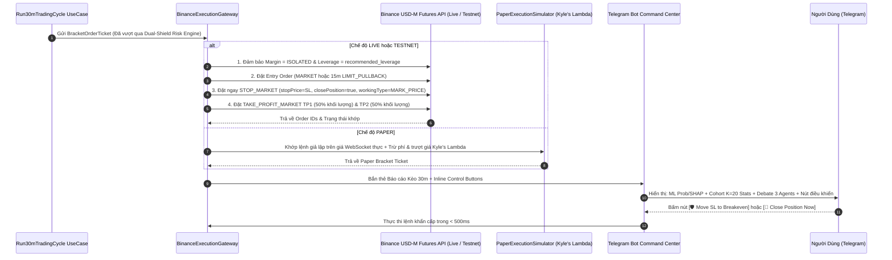

# 08 — Thiết Kế `Binance Execution Gateway` (`Bracket Order`), `Telegram Command Center` & `Docker Compose` Toàn Trình

> [!IMPORTANT]
> **Mục tiêu Pattern 8:** Đảm bảo khâu thực thi lệnh trên **Binance USD-M Futures** an toàn tuyệt đối với cơ chế **`Exchange-Side Bracket Order`** (luôn gắn kèm lệnh `STOP_MARKET` bảo vệ trực tiếp trên máy chủ Binance), hỗ trợ chuyển đổi nóng không cần khởi động lại giữa 3 chế độ **`PAPER` $\leftrightarrow$ `TESTNET` $\leftrightarrow$ `LIVE`** ngay trên **Telegram Command Center**, và đóng gói toàn bộ hệ thống (`TimescaleDB+pgvector`, `Redis 7`, `9router`, `TradingBot`) trong một file `docker-compose.yml` chuẩn Production.

---

## 1. Sơ Đồ Luồng Thực Thi `Bracket Order` & Điều Khiển Qua Telegram



---

## 2. Đặc Tả `BinanceExecutionGateway` & Bảo Vệ Lệnh Trên Sàn (`futures_rest_gateway.py`)

### 2.1. Quy Tắc Đặt Cụm Lệnh Bảo Vệ Nguyên Tử (`Atomic Bracket Order Protocol`)

1. **Chế độ Ký quỹ Cô lập (`ISOLATED Margin`):**
   - Mọi cặp giao dịch (`BTCUSDT`, `ETHUSDT`, `SOLUSDT`, `BNBUSDT`) bắt buộc đặt ở chế độ `ISOLATED` với đòn bẩy khuyến nghị từ `DeterministicRiskCalculator` ($\le 5\text{x}$) để rủi ro bất khả kháng của 1 mã không bao giờ ảnh hưởng sang số dư tổng.
2. **Bảo vệ Stop-Loss trực tiếp trên máy chủ Binance (`workingType="MARK_PRICE"`):**
   - Ngay khi đặt lệnh Entry, hệ thống gửi kèm lệnh `STOP_MARKET` với tham số `closePosition="true"` và `workingType="MARK_PRICE"`:
     - Dùng `MARK_PRICE` giúp chống bị quét SL oan bởi các râu nến ảo cục bộ trên một sàn (`Last Price Spike`), nhưng vẫn kích hoạt cắt lỗ tự động trên máy chủ Binance ngay cả khi máy chủ Bot bị mất điện hoặc đứt cáp mạng!
3. **Cơ chế Chốt lời 2 Nhịp (`TP1` & `TP2`) + Tự động Dời SL về Hòa vốn (`Auto-Breakeven`):**
   - **`TP1` (50% khối lượng vị thế):** Đặt tại mức `1.2x Net Risk` (ngay khi khớp `TP1`, hệ thống tự động hủy SL cũ và đặt lệnh `STOP_MARKET` mới tại `entry_price * (1 ± roundtrip_fee)` để khóa cứng phần lệnh còn lại **không thể thua**!).
   - **`TP2` (50% khối lượng còn lại):** Đặt tại mức `take_profit_price` mục tiêu của `Trade Architect`.
4. **Cơ chế Hủy Lệnh Chờ Quá Hạn (`Stale Limit Order Cancellation`):**
   - Nếu `Trade Architect` chọn kiểu vào lệnh `LIMIT_PULLBACK_15M` nhưng sau **2 cây nến `15m` (`30 phút`)** giá đã chạy đi mất mà chưa khớp lệnh Limit, hệ thống tự động hủy lệnh Limit chờ và hủy các lệnh SL/TP đi kèm để tránh khớp lệnh muộn khi cấu trúc thị trường đã đổi.

### 2.2. Code Mẫu Đặt Cụm `Bracket Order` Bất Đồng Bộ (`src/infrastructure/binance/futures_rest_gateway.py`)

```python
"""Binance USD-M Futures Execution Gateway — Zero Default Params, Zero Hardcoded URLs/Timeouts."""
from __future__ import annotations

from dataclasses import dataclass
import hashlib
import hmac
import time
from urllib.parse import urlencode
import httpx
from src.domain.entities.enums import EntryOrderType, ExecutionMode, TradeSide


@dataclass
class BinanceGatewayConfig:
    api_key: str
    api_secret: str
    live_base_url: str
    testnet_base_url: str
    recv_window_ms: int
    http_timeout_seconds: float
    working_type: str
    limit_time_in_force: str


class BinanceFuturesExecutionGateway:
    def __init__(
        self,
        cfg: BinanceGatewayConfig,
        mode: ExecutionMode,
    ) -> None:
        self.cfg = cfg
        self.mode = mode

    @property
    def base_url(self) -> str:
        if self.mode == ExecutionMode.LIVE:
            return self.cfg.live_base_url
        if self.mode == ExecutionMode.TESTNET:
            return self.cfg.testnet_base_url
        raise RuntimeError(f"Không được gọi REST Binance trực tiếp khi đang ở chế độ {self.mode}")

    def _sign_params(self, params: dict[str, str | int | float]) -> str:
        params["timestamp"] = int(time.time() * 1000)
        params["recvWindow"] = self.cfg.recv_window_ms
        query = urlencode(params)
        signature = hmac.new(
            self.cfg.api_secret.encode("utf-8"),
            query.encode("utf-8"),
            hashlib.sha256,
        ).hexdigest()
        return f"{query}&signature={signature}"

    async def place_exchange_bracket_order(
        self,
        symbol: str,
        side: TradeSide,
        entry_type: EntryOrderType,
        quantity: float,
        entry_price: float,
        stop_loss_price: float,
        take_profit_price: float,
        leverage: int,
    ) -> dict:
        headers = {"X-MBX-APIKEY": self.cfg.api_key}
        if side == TradeSide.LONG:
            entry_side = "BUY"
            exit_side = "SELL"
        elif side == TradeSide.SHORT:
            entry_side = "SELL"
            exit_side = "BUY"
        else:
            raise ValueError(f"Side đặt lệnh không hợp lệ: {side}")

        async with httpx.AsyncClient(
            base_url=self.base_url,
            headers=headers,
            timeout=self.cfg.http_timeout_seconds,
        ) as client:
            # 1. Thiết lập đòn bẩy cho mã
            lev_q = self._sign_params({"symbol": symbol, "leverage": leverage})
            await client.post(f"/fapi/v1/leverage?{lev_q}")

            # 2. Đặt lệnh Entry (MARKET hoặc LIMIT)
            entry_params: dict[str, str | int | float] = {
                "symbol": symbol,
                "side": entry_side,
                "quantity": quantity,
            }
            if entry_type == EntryOrderType.MARKET:
                entry_params["type"] = "MARKET"
            else:
                entry_params["type"] = "LIMIT"
                entry_params["price"] = entry_price
                entry_params["timeInForce"] = self.cfg.limit_time_in_force

            entry_resp = await client.post(f"/fapi/v1/order?{self._sign_params(entry_params)}")
            entry_resp.raise_for_status()

            # 3. Đặt lệnh Bảo vệ STOP_MARKET trực tiếp trên máy chủ Binance
            sl_params = {
                "symbol": symbol,
                "side": exit_side,
                "type": "STOP_MARKET",
                "stopPrice": stop_loss_price,
                "closePosition": "true",
                "workingType": self.cfg.working_type,
                "priceProtect": "TRUE",
            }
            sl_resp = await client.post(f"/fapi/v1/order?{self._sign_params(sl_params)}")
            sl_resp.raise_for_status()

            # 4. Đặt lệnh Chốt lời TAKE_PROFIT_MARKET trên máy chủ Binance
            tp_params = {
                "symbol": symbol,
                "side": exit_side,
                "type": "TAKE_PROFIT_MARKET",
                "stopPrice": take_profit_price,
                "closePosition": "true",
                "workingType": self.cfg.working_type,
                "priceProtect": "TRUE",
            }
            tp_resp = await client.post(f"/fapi/v1/order?{self._sign_params(tp_params)}")
            tp_resp.raise_for_status()

            return {
                "entry_order": entry_resp.json(),
                "sl_order": sl_resp.json(),
                "tp_order": tp_resp.json(),
            }
```

### 2.3. Bộ Đồng Bộ Ngữ Cảnh Tài Khoản & Vị Thế Thời Gian Thực (`AccountStateSynchronizer`)

Trước mỗi chu kỳ đánh giá `30m` (và sau mỗi sự kiện đóng/mở lệnh hoặc dời SL về hòa vốn), dịch vụ `AccountStateSynchronizer` kết hợp dữ liệu từ **Binance REST (`/fapi/v2/account`, `/fapi/v2/positionRisk`, `/fapi/v1/openOrders`)** (hoặc **Paper Portfolio Ledger** khi ở chế độ `PAPER`) cùng bảng `orders_and_positions` & `account_equity_snapshots` trong `TimescaleDB` để lắp ráp đối tượng **`AccountPortfolioContext`** đẩy lên Redis (`account:live_context:{mode}`) và truyền trực tiếp vào **Agent 3 (`Risk Arbiter`)** + **`DeterministicRiskCalculator`**:
- Tính chính xác `available_margin_usd` và `margin_utilization_pct` để không bao giờ duyệt lệnh vượt quá số dư ký quỹ khả dụng.
- Kiểm tra từng vị thế đang mở xem `stop_loss_price` hiện tại đã khóa trên/dưới `entry_price` chưa (`is_sl_at_breakeven = True`) để tách biệt **`raw_open_heat_pct`** (rủi ro danh nghĩa) và **`effective_open_heat_pct`** (rủi ro mất tiền thực tế của các lệnh chưa khóa hòa vốn).
- Cung cấp `net_btc_beta_exposure_usd`, `remaining_daily_dd_budget_pct`, và `consecutive_losses_count` để `Risk Arbiter` xét duyệt tương quan danh mục chuẩn xác.

---

## 3. Thiết Kế Trung Tâm Chỉ Huy `Telegram Bot Command Center` (`src/presentation/telegram/`)

### 3.1. Bảng Lệnh Điều Khiển (`Slash Commands`)

| Lệnh Telegram | Chức năng chi tiết |
| :--- | :--- |
| `/status` | Hiển thị tổng quan tài khoản (`NAV`, `Daily PnL`, `Max Drawdown`, `Open Heat %`), chế độ hiện hành (`PAPER / TESTNET / LIVE`) và trạng thái sức khỏe kết nối WebSocket / DB / `9router`. |
| `/positions` | Liệt kê các vị thế đang mở kèm nút bấm nhanh `[🛡️ Dời SL về Hòa vốn]` và `[🚨 Đóng lệnh ngay]`. |
| `/shadow` | Xem danh sách các **Lệnh ảo (`Shadow Orders`)** đang theo dõi ngầm và thống kê tỷ lệ `Risk Arbiter` cứu thua đúng (`Validated Defense`) vs bỏ lỡ (`Missed Opportunity`). |
| `/quota` | Hiển thị bảng thanh trạng thái `% RPM`, `% TPM`, `% RPD` và trạng thái `OK / COOLDOWN` của từng API con phía sau `9router` từ Redis. |
| `/mode <paper\|testnet\|live>` | Chuyển đổi nóng chế độ khớp lệnh ngay lập tức mà không cần khởi động lại container. |
| `/memory <symbol>` | Xem thống kê kho bộ nhớ `pgvector` của mã đó (`Tổng số ca`, `Top-3 bài học có điểm uy tín cao nhất`, `Số bài học đã bị đào thải`). |
| `/pause <hours>` / `/resume` | Tạm ngưng đặt lệnh thật trong $X$ giờ (chuyển toàn bộ sang chạy Lệnh ảo Shadow) hoặc mở lại. |
| `/panic_close_all` | **Nút Đỏ Khẩn Cấp:** Đóng toàn bộ vị thế đang mở trên Binance bằng lệnh Market, hủy mọi lệnh chờ và chuyển bot về trạng thái `PAUSED`. |

### 3.2. Mẫu Tin Nhắn Báo Cáo Chu Kỳ 30m Trên Telegram

```text
🟢 [SOLUSDT | 30m CYCLE] — APPROVED LONG (PAPER MODE)
━━━━━━━━━━━━━━━━━━━━━━━━━━━━━━━━━━
📌 Playbook: TREND_CONTINUATION_BREAKOUT
📊 Regime: STRONG_TREND_BULL (Hurst: 0.63 | YZ-Vol: 0.58%)
🛡️ OOD Distance: 2.14 (Normal < 4.35) | Macro: CALM

🤖 DUAL-BINARY CAUSAL ML & SHAP:
• P(Long Win Net): 64.2% (±4.1% Venn-Abers) | P(Short): 13.8%
• Top Bullish SHAP:
  1. oi_directional_score (+0.11 | IC_30d: +0.048): LONG_BUILDUP (+2.1σ)
  2. hurst_exponent_100 (+0.09 | IC_30d: +0.039): Persistent Trend
  3. taker_cvd_z_24 (+0.07 | IC_30d: +0.034): Aggressive Buyer Flow
• Risk Factor: vpin_toxicity (72nd pct | Moderate)

🧠 COHORT MEMORY (K=20 Nearest Cases in pgvector):
• Cohort Win-Rate: 71.5% | Stop-Hunt Rate: 14.0% | Expectancy: +1.42R
• 80th-Percentile Historical MAE: -1.18x ATR

⚖️ 3-AGENT DEBATE DIGEST:
• Scout: Đồng thuận Long cùng hướng BTC (+0.85σ Lead).
• Architect: Chọn LIMIT_PULLBACK_15M tại 184.20 (tiết kiệm phí Maker), đặt SL tại 181.60 (-1.35x ATR > 80th MAE để chống Stop-Hunt), TP tại 189.40.
• Risk Arbiter: APPROVE_FULL | Net R:R = 1.92 | Quarter-Kelly Risk = 0.58% NAV ($58.00).
━━━━━━━━━━━━━━━━━━━━━━━━━━━━━━━━━━
[🛡️ Move SL to BE]  [🚨 Close Now]  [⏸️ Pause SOL 4h]
```

---

## 4. Đặc Tả File `docker-compose.yml` Toàn Hệ Thống

File `docker-compose.yml` đóng gói toàn bộ 4 dịch vụ cốt lõi với mạng nội bộ cô lập và lưu trữ bền vững:

```yaml
services:
  timescaledb:
    image: timescale/timescaledb-ha:pg16
    container_name: trading_timescaledb_pgvector
    restart: unless-stopped
    environment:
      POSTGRES_DB: ${POSTGRES_DB:?Missing POSTGRES_DB in .env}
      POSTGRES_USER: ${POSTGRES_USER:?Missing POSTGRES_USER in .env}
      POSTGRES_PASSWORD: ${POSTGRES_PASSWORD:?Missing POSTGRES_PASSWORD in .env}
    ports:
      - "${POSTGRES_PORT:?Missing POSTGRES_PORT in .env}:5432"
    volumes:
      - tsdb_data:/home/postgres/pgdata/data
      - ./sql/001_init_schema.sql:/docker-entrypoint-initdb.d/001_init_schema.sql:ro
    healthcheck:
      test: ["CMD-SHELL", "pg_isready -U ${POSTGRES_USER} -d ${POSTGRES_DB}"]
      interval: 10s
      timeout: 5s
      retries: 5

  redis:
    image: redis:7-alpine
    container_name: trading_redis_governor
    restart: unless-stopped
    command: ["redis-server", "--appendonly", "yes", "--maxmemory", "512mb", "--maxmemory-policy", "noeviction"]
    ports:
      - "6379:6379"
    volumes:
      - redis_data:/data
    healthcheck:
      test: ["CMD", "redis-cli", "ping"]
      interval: 10s
      timeout: 3s
      retries: 5

  ninerouter:
    image: node:20-alpine
    container_name: trading_9router_gateway
    restart: unless-stopped
    working_dir: /app
    command: ["sh", "-c", "npx -y 9router@latest --port 20128 --host 0.0.0.0"]
    ports:
      - "20128:20128"
    volumes:
      - ninerouter_config:/root/.9router

  trading-bot:
    build:
      context: .
      dockerfile: Dockerfile
    container_name: llm_trading_bot_v2_core
    restart: unless-stopped
    env_file:
      - .env
    depends_on:
      timescaledb:
        condition: service_healthy
      redis:
        condition: service_healthy
      ninerouter:
        condition: service_started
    volumes:
      - ./config:/app/config:ro
      - ./data/parquet:/app/data/parquet
      - ./data/models:/app/data/models

volumes:
  tsdb_data:
  redis_data:
  ninerouter_config:
```

---

## 5. Checklist Nghiệm Thu Stage 6 (`Doc 08`)

- [ ] Kiểm thử `docker compose up -d` khởi chạy thành công cả 4 containers (`timescaledb`, `redis`, `ninerouter`, `trading-bot`).
- [ ] Kiểm thử đặt lệnh `Bracket Order` trên **Binance Futures Testnet** và **Paper Simulator**, xác nhận cả 3 lệnh (`Entry`, `STOP_MARKET`, `TAKE_PROFIT_MARKET`) đều được ghi nhận và hiển thị đầy đủ trên Telegram Bot.
- [ ] Kiểm thử bấm các nút `[🛡️ Move SL to BE]`, `[🚨 Close Now]`, `/quota`, và `/mode` trực tiếp trên Telegram.
